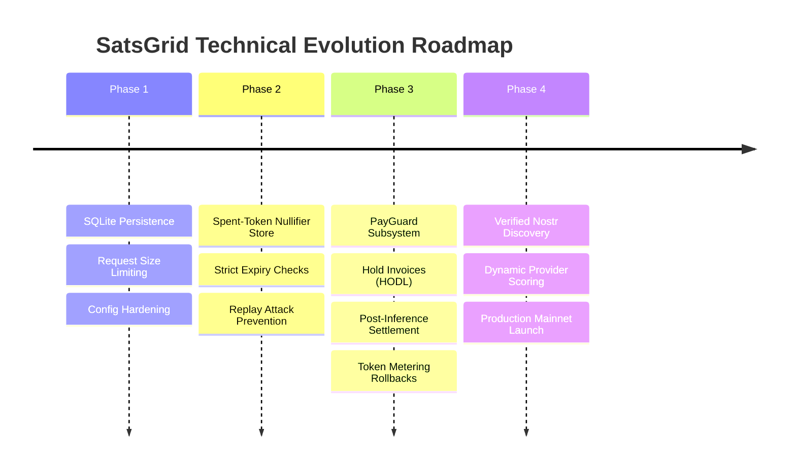

# Phase 0 Audit: SatsGrid Evolution & PayGuard Roadmap

**Status:** PLANNED & ARCHITECTURAL SPECIFICATION  
**Objective:** Transition SatsGrid from inherited prototype to production-grade permissionless compute network.

---

## 1. Evolution Philosophy

The inherited codebase provides a strong, elegant foundation in Rust: Axum HTTP routing, L402 challenge negotiation, SSE token streaming, and an intuitive Next.js portal. However, its economic and state models contain critical vulnerabilities that preclude production mainnet deployment.

Our evolution strategy follows four phased milestones:
1. **Milestone 1: Core Foundation Hardening & Persistent State (SQLite)**
2. **Milestone 2: Replay Prevention & Single-Use Nullifier Architecture**
3. **Milestone 3: PayGuard Subsystem Specification & Hold Invoices**
4. **Milestone 4: Decentralized Routing & Reputation Layer**

---

## 2. Phased Roadmap

---

## 3. Milestone Details

### Milestone 1: Core Foundation Hardening & SQLite State Layer
- **Goal:** Eliminate volatile in-memory loss and protect the node against basic denial-of-service.
- **Key Deliverables:**
  - Introduce `sqlx` with an embedded SQLite database (`~/.satsgrid/state.db`).
  - Persist `sessions` table (`id`, `model`, `budget_sats`, `remaining_sats`, `macaroon`, `preimage`, `created_at`, `status`).
  - Persist node operator financial telemetry (`total_sats_earned`, `total_requests`).
  - Wrap Axum router with `tower_http::limit::RequestBodyLimitLayer` (e.g. 10MB limit) to prevent memory exhaustion DoS.
  - Fix documentation discrepancies (align remaining `infernos` references in docs to `satsgrid`).

### Milestone 2: Cryptographic Nullifier & Replay Prevention
- **Goal:** Close the infinite-replay vulnerability on pay-per-request tokens.
- **Key Deliverables:**
  - Create a persistent `nullifiers` table in SQLite (`payment_hash`, `preimage`, `spent_at`, `expires_at`).
  - For pay-per-request invocations, the L402 verifier atomically checks if `payment_hash` exists in the nullifier store:
    - If found: return `HTTP 401 Unauthorized ("Token already redeemed")`.
    - If not found: insert nullifier and allow request execution.
  - Implement periodic background pruning for expired nullifier records.

### Milestone 3: PayGuard Request-Level Payment Integrity
- **Goal:** Solve the "Payment Before Execution" dilemma using Lightning Hold Invoices (HODL invoices).
- **Core Problem Solved:** Callers must not lose sats if the node fails to deliver tokens; nodes must not deliver tokens without guaranteed payment.
- **PayGuard Mechanism:**
  1. **Hold Invoice Creation:** The node generates an L402 challenge backed by an LND hold invoice.
  2. **Caller Hold:** Caller routes payment. The sats are locked in the Lightning HTLC pipeline, but not yet claimed by the node.
  3. **Verified Execution:** SatsGrid invokes the upstream LLM (Ollama / vLLM).
  4. **Conditional Settlement:**
     - **Success:** Upstream returns tokens → Node releases preimage → HTLC settles and node claims satoshis.
     - **Failure:** Upstream OOMs / crashes / timeouts → Node cancels hold invoice → HTLC cancels and caller automatically retains 100% of their funds.
  5. **PayGuard Token Metering:** For streaming sessions, hold invoices are settled incrementally or rolled back on connection dropouts.

### Milestone 4: Decentralized Discovery & Provider Reputation
- **Goal:** Prevent relay spam and allow autonomous callers to select reliable nodes.
- **Key Deliverables:**
  - Cryptographic verification of node operator pubkeys.
  - Optional proof-of-work (NIP-13) or Lightning stake-bound announcements to eliminate relay spam.
  - Caller-side latency and benchmark tracking to rank discovered nodes.
