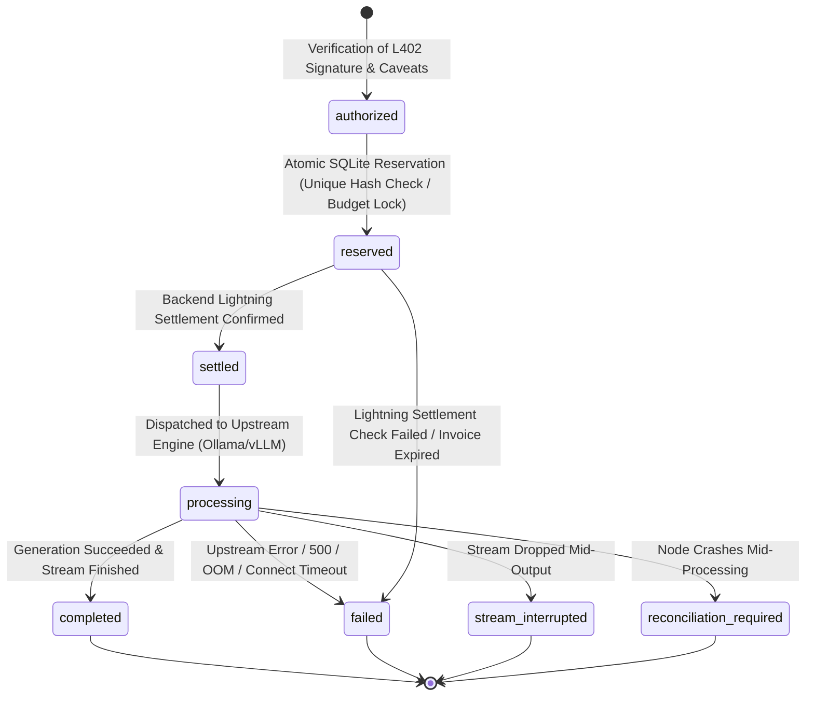
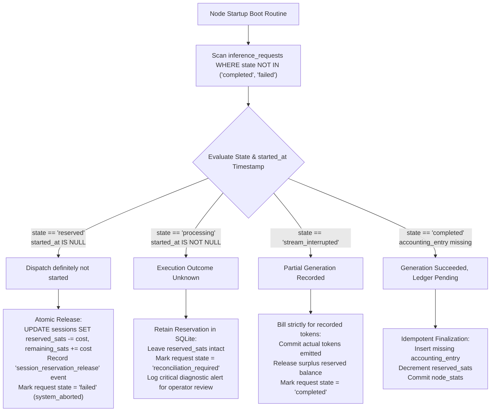

# Phase 1A: Persistent State & Security Architecture Plan

**Auditor & Systems Architect:** Senior Rust Systems Architect  
**Document:** `docs/audit/09-phase1-architecture-plan.md`  
**Date:** 2026-11-05  
**Target Repository:** `/home/mobile_dev/Desktop/Ucee/BossBattle/satsgrid`  
**Phase:** Phase 1A — Foundation Stabilization, Transactional Persistence & Security Hardening  
**Scope:** DESIGN SPECIFICATION ONLY — ZERO CODE MODIFICATIONS IN THIS TASK  

---

## 1. Executive Summary

Following the Phase 0 audit reconciliation (`docs/audit/08-audit-reconciliation.md`), this document provides an exhaustive, production-grade architectural blueprint for **Phase 1A: Foundation Stabilization**.

SatsGrid's inherited prototype executes L402 challenge negotiation, SSE token streaming, and dynamic pricing successfully across 102 passing unit and integration tests. However, its current operational integrity is compromised by three structural vulnerabilities:
1. **Pay-Per-Request Credential Replay:** A paid, settled L402 credential can be reused indefinitely within its 1-hour expiration window because no spent-token / nullifier store exists.
2. **Volatile RAM State:** Session budgets, node operator financial accounting (`total_sats_earned`, `total_requests`), and active credentials exist strictly in an ephemeral `HashMap` in memory. A power interruption, crash, or binary update wipes all balances and metrics.
3. **Pre-Inference Economic Risk:** Monies are deducted and recorded *before* upstream LLM generation. When Ollama crashes, times out, or encounters Out-of-Memory (OOM) errors, callers suffer financial loss without model output.

This design introduces an embedded, transactional **SQLite** persistence layer using `sqlx` (pure SQLite driver with write-ahead logging), an atomic **two-phase request reservation & consumption** mechanism for single-use L402 tokens, durable **session budgets**, Axum **request size & timeout security wrappers**, and a small, non-breaking fix for **Docker Compose network routing**.

---

## 2. Current Architecture & Execution Flow Audit

### 2.1 The As-Is Request Lifecycle
In `src/node/api/handlers.rs` (`chat_completions`):
1. **Unauthenticated Request:** Request arrives at `POST /v1/chat/completions`. If the `Authorization` header is absent or empty, the node creates an invoice via `state.lightning.create_invoice(cost, ...)` and mints an HMAC-SHA256 macaroon with `caveats: [capability = inference, expires_at = now + 3600]`. It responds with HTTP `402 Payment Required` and header `WWW-Authenticate: L402 token="...", invoice="..."`.
2. **Payment by Caller:** Caller settles the invoice out-of-band via Lightning (WebLN, NWC, or LND).
3. **Presentation of Credentials:** Caller resubmits the request with `Authorization: L402 <macaroon_base64>:<preimage_hex>`.
4. **Verification (`src/node/gate/verify.rs`):**
   - Hashes the preimage: `SHA256(preimage)`.
   - Checks `computed_hash == macaroon.identifier` (which equals `invoice.payment_hash`).
   - Verifies macaroon HMAC signature using server root key.
   - Evaluates caveats: `now < expires_at`, `model == requested_model`, `capability == "inference"`.
   - Queries Lightning backend: `backend.is_invoice_settled(&payment_hash)`.
5. **Execution & Debit:**
   - If a `session` caveat exists: debits `cost` from in-memory `SessionBudgetManager` (`AtomicU64` CAS).
   - If pay-per-request: proceeds directly.
   - **Financial accounting incremented immediately:** `stats.total_requests += 1`, `stats.total_sats_earned += cost`.
6. **Upstream Forwarding (`src/node/proxy/openai.rs`):**
   - Forwards request body to `http://127.0.0.1:11434/v1/chat/completions`.
   - If streaming (`stream: true`): pipes upstream SSE byte chunks to client.
   - If non-streaming: awaits full JSON response and returns to client.

### 2.2 Flaws in the As-Is Flow
- **No Uniqueness Guard:** At step 4/5, if the caller sends the identical header 1,000 times, the invoice remains "settled" on LND/Mock/NWC, and every request is accepted without further payment.
- **No Failure Rollback:** At step 6, if the proxy fails, the session satoshis were already deducted, and stats were already incremented.
- **Memory Wipe:** At step 5, all session budgets are in `Arc<RwLock<HashMap<String, SessionBudget>>>`.

---

## 3. Proposed SQLite Architecture

### 3.1 Crate Selection: `sqlx` (SQLite)
We introduce `sqlx = { version = "0.8", default-features = false, features = ["runtime-tokio", "sqlite", "macros", "chrono", "uuid"] }`.

**Rationale over alternatives:**
- **`sqlx` vs `rusqlite`:** `rusqlite` is synchronous and requires wrapping every database access in `tokio::task::spawn_blocking`, incurring thread-pool switching overhead. `sqlx` is fully asynchronous, native to Tokio, provides asynchronous connection pooling (`SqlitePool`), and supports non-blocking transactions.
- **Self-Contained / Zero Daemon:** SQLite embeds directly into the `satsgrid` binary. It requires no external server process (like PostgreSQL or MySQL), ensuring single-binary deployment remains 100% self-sovereign and portable on operators' edge rigs.
- **Storage Path:** Defaults to `<data_dir>/state.db` (e.g. `~/.satsgrid/state.db` or `/var/lib/satsgrid/state.db`).

### 3.2 PRAGMA & Concurrency Configuration
Upon opening `SqlitePool`, the node executes the following initialization PRAGMAs:
```sql
PRAGMA journal_mode = WAL;          -- Write-Ahead Logging for high-concurrency read/write
PRAGMA synchronous = NORMAL;         -- Balances durability with NVMe/SSD write throughput
PRAGMA foreign_keys = ON;           -- Enforces referential integrity
PRAGMA busy_timeout = 5000;         -- 5-second lock timeout before SQLITE_BUSY
```

---

## 4. Database Schema Specification

```sql
-- ============================================================================
-- SATSGRID PHASE 1A PERSISTENCE SCHEMA
-- ============================================================================

-- 1. SESSIONS: Durable session budgets and lifecycle
CREATE TABLE IF NOT EXISTS sessions (
    id TEXT PRIMARY KEY,                       -- UUID v4 string (e.g. "550e8400-e29b-41d4-a716-446655440000")
    payment_hash TEXT NOT NULL UNIQUE,         -- Associated initial funding invoice hash (hex 64 chars)
    total_budget_sats INTEGER NOT NULL,        -- Initial granted budget in Satoshis
    remaining_sats INTEGER NOT NULL,           -- Current remaining spendable balance
    model_restriction TEXT,                    -- Optional caveat restriction (e.g. "llama3.2")
    status TEXT NOT NULL,                      -- 'active', 'exhausted', 'expired', 'closed'
    created_at INTEGER NOT NULL,               -- Unix epoch timestamp (seconds)
    expires_at INTEGER NOT NULL,               -- Unix epoch timestamp (seconds)
    updated_at INTEGER NOT NULL                -- Unix epoch timestamp (seconds)
);

CREATE INDEX IF NOT EXISTS idx_sessions_status ON sessions(status);
CREATE INDEX IF NOT EXISTS idx_sessions_expires_at ON sessions(expires_at);

-- 2. NULLIFIERS: Single-use registry for pay-per-request L402 credentials
CREATE TABLE IF NOT EXISTS nullifiers (
    payment_hash TEXT PRIMARY KEY,             -- Macaroon identifier / Payment hash (hex 64 chars)
    preimage TEXT NOT NULL,                    -- Cryptographic proof of payment (hex 64 chars)
    consumed_at INTEGER NOT NULL,              -- Unix epoch timestamp when request was reserved/consumed
    expires_at INTEGER NOT NULL,               -- Macaroon caveat expiry timestamp
    request_id TEXT NOT NULL                   -- Unique internal request trace UUID
);

CREATE INDEX IF NOT EXISTS idx_nullifiers_expires_at ON nullifiers(expires_at);

-- 3. REQUEST_LOGS: Audit trail of inference dispatches and settlement state
CREATE TABLE IF NOT EXISTS request_logs (
    id TEXT PRIMARY KEY,                       -- Internal Request UUID
    session_id TEXT REFERENCES sessions(id),   -- NULL for single pay-per-request
    payment_hash TEXT NOT NULL,                -- Payment hash used for authorization
    model TEXT NOT NULL,                       -- Requested model identifier
    prompt_tokens INTEGER NOT NULL,            -- Estimated or actual prompt tokens
    completion_tokens INTEGER,                 -- Actual completion tokens generated (NULL if failed)
    charged_sats INTEGER NOT NULL,             -- Sats debited / cost of request
    status TEXT NOT NULL,                      -- 'reserved', 'completed', 'failed', 'stream_interrupted'
    error_message TEXT,                        -- Diagnostic failure detail if status = 'failed'
    duration_ms INTEGER,                       -- End-to-end execution latency
    created_at INTEGER NOT NULL,               -- Unix epoch timestamp
    completed_at INTEGER                       -- Unix epoch timestamp
);

CREATE INDEX IF NOT EXISTS idx_request_logs_payment_hash ON request_logs(payment_hash);
CREATE INDEX IF NOT EXISTS idx_request_logs_session_id ON request_logs(session_id);
CREATE INDEX IF NOT EXISTS idx_request_logs_created_at ON request_logs(created_at);

-- 4. NODE_STATS: Durable node operator accounting metrics
CREATE TABLE IF NOT EXISTS node_stats (
    singleton_id INTEGER PRIMARY KEY CHECK (singleton_id = 1),
    total_requests INTEGER NOT NULL DEFAULT 0,
    total_sats_earned INTEGER NOT NULL DEFAULT 0,
    updated_at INTEGER NOT NULL
);

-- Seed initial row if absent
INSERT OR IGNORE INTO node_stats (singleton_id, total_requests, total_sats_earned, updated_at)
VALUES (1, 0, 0, unixepoch());
```

### 4.1 Data Durability vs. Ephemerality Matrix
| Data Entity | Storage Location | Durability | Rationale |
|---|---|---|---|
| **Macaroon Root Key** | File: `.satsgrid_macaroon_key` | Persistent | Needed to verify unexpired credentials across restarts. |
| **Admin Token** | File / Config / Env | Persistent | Preserves operator dashboard access across restarts. |
| **Single-Use Nullifiers** | Table: `nullifiers` | Persistent (with TTL) | Prevents replay across server restarts. Pruned after `expires_at`. |
| **Session Budgets** | Table: `sessions` | Persistent | Preserves caller satoshis across node maintenance/reboots. |
| **Financial Accounting** | Table: `node_stats` | Persistent | Guarantees operator earnings are never wiped on power loss. |
| **Inference Prompts/Outputs**| *None (RAM only)* | **Strictly Ephemeral**| Preserves the core privacy guarantee of zero prompt logging. |

---

## 5. Replay Protection Design

### 5.1 Dual-Mode Credential Differentiation
When an incoming `Authorization: L402 <macaroon>:<preimage>` header arrives:
1. `SessionBudgetManager::extract_session_caveats(&macaroon)` checks for a `session = <uuid>` caveat.
2. **If `session` caveat IS present:** The credential is a **Session Token**. It is governed by session budget depletion and expiry timestamp. It is **NOT** inserted into the `nullifiers` table.
3. **If `session` caveat IS NOT present:** The credential is a **Pay-Per-Request Token**. It is valid for **exactly one** successful inference execution.

### 5.2 Atomic Nullifier Reservation (Two-Phase Execution)
To prevent race conditions where two concurrent requests present the identical pay-per-request credential simultaneously:
1. **Verification Phase:** The node validates HMAC signature, expiration caveat, and checks with the Lightning backend that `is_invoice_settled(&payment_hash) == true`.
2. **Atomic Reservation (`INSERT OR ROLLBACK`):**
   ```sql
   INSERT INTO nullifiers (payment_hash, preimage, consumed_at, expires_at, request_id)
   VALUES (?1, ?2, unixepoch(), ?3, ?4);
   ```
   - If the payment hash already exists in `nullifiers`, SQLite returns a `UNIQUE constraint failed: nullifiers.payment_hash` error.
   - The handler immediately intercepts this error and returns `HTTP 401 Unauthorized`:
     ```json
     {
       "error": "Payment token has already been redeemed. Pay-per-request tokens are single-use."
     }
     ```
   - Because SQLite WAL transactions are serializable/atomic, exactly one concurrent request can successfully insert the record. All parallel racing requests are rejected instantly.

### 5.3 Handling Upstream Failures on Single-Use Tokens
What if the single-use token was consumed in SQLite, but Ollama crashes immediately before generating any tokens?
- If the node simply leaves the token consumed, the user lost their sats with zero output.
- **Phase 1A Strategy:** In Phase 1A (prior to PayGuard hold-invoices), the request is tracked in `request_logs` with `status = 'reserved'`. If the upstream engine returns an unrecoverable HTTP 500 or connection error prior to sending any response bytes, the node initiates an atomic **nullifier release**:
  ```sql
  DELETE FROM nullifiers WHERE payment_hash = ?1 AND request_id = ?2;
  ```
  This returns the credential to an unspent state, allowing the caller to retry the request once the node/Ollama recovers.
- If the upstream engine *did* stream tokens and then disconnected midway, the nullifier remains consumed to prevent double-spending compute.

---

## 6. Payment and Inference Failure Lifecycle

```mermaid
sequenceDiagram
    autonumber
    actor Caller as Caller / Agent
    participant Gate as SatsGrid Node (L402 Gate)
    participant DB as SQLite (state.db)
    participant LN as Lightning Backend
    participant Upstream as Ollama / vLLM

    Caller->>Gate: POST /v1/chat/completions (No Auth)
    Gate->>LN: create_invoice(cost, memo)
    LN-->>Gate: Invoice (payment_hash, bolt11)
    Gate-->>Caller: HTTP 402 + WWW-Authenticate (L402 challenge)

    Caller->>LN: Settle Invoice via Lightning
    Caller->>Gate: POST /v1/chat/completions (Auth: L402 macaroon:preimage)

    Gate->>Gate: Verify HMAC signature, caveats, expiry
    Gate->>LN: is_invoice_settled(payment_hash)
    LN-->>Gate: true

    alt Pay-Per-Request Mode
        Gate->>DB: INSERT INTO nullifiers (payment_hash, request_id)
        alt Unique Constraint Violation
            DB-->>Gate: Constraint Error
            Gate-->>Caller: HTTP 401 Unauthorized (Token already spent)
        else Insert Succeeded
            DB-->>Gate: OK (Reserved)
        end
    else Session Budget Mode
        Gate->>DB: UPDATE sessions SET remaining_sats = remaining_sats - cost WHERE id = ? AND remaining_sats >= cost
        alt Insufficient Balance
            DB-->>Gate: 0 rows updated
            Gate-->>Caller: HTTP 402 Payment Required (Budget exhausted)
        else Balance Deducted
            DB-->>Gate: OK (New Balance)
        end
    end

    Gate->>Upstream: Forward Request (/v1/chat/completions)

    alt Upstream Fails / Timeout / Connection Error
        Upstream-->>Gate: 500 Internal Error / Connection Drop
        alt Pay-Per-Request
            Gate->>DB: DELETE FROM nullifiers WHERE payment_hash = ? AND request_id = ? (Release Token)
        else Session Mode
            Gate->>DB: UPDATE sessions SET remaining_sats = remaining_sats + cost (Credit Balance)
        end
        Gate-->>Caller: HTTP 502 Bad Gateway (Upstream failed; funds restored)
    else Upstream Success
        Upstream-->>Gate: SSE Stream / JSON Output
        Gate->>DB: UPDATE node_stats SET total_requests = total_requests + 1, total_sats_earned = total_sats_earned + cost
        Gate->>DB: UPDATE request_logs SET status = 'completed'
        Gate-->>Caller: HTTP 200 OK (Stream output with X-SatsGrid headers)
    end
```

### Failure Mode Resolution Matrix
| Failure Scenario | Phase 1A Action (Immediate) | Phase 2 / PayGuard Action (Future) |
|---|---|---|
| **Upstream 500 / OOM (Pre-stream)** | Delete nullifier / Roll back session balance; return 502. | Cancel LND Hold Invoice; 100% HTLC cancellation. |
| **Upstream Timeout (Pre-stream)** | Delete nullifier / Roll back session balance; return 504. | Cancel LND Hold Invoice; caller retains sats. |
| **Client Disconnects Mid-Stream** | Token remains consumed (compute was already expended). | Settle hold invoice partially for delivered tokens. |
| **Node Power Failure Mid-Stream** | SQLite WAL preserves pre-crash state; nullifier committed. | HTLC automatically expires and refunds caller via CLTV timelock. |
| **Lightning Backend Offline** | L402 verification returns 502 Bad Gateway. | Node refuses new invoices until Lightning reconnects. |

---

## 7. Session Persistence Architecture

### 7.1 Hybrid Memory + SQLite Architecture
To maintain maximum throughput and avoid database contention on high-frequency streaming chunk requests while guaranteeing durability across restarts:
1. **Startup Synchronization:** Upon node startup, `SessionBudgetManager` queries `SELECT * FROM sessions WHERE status = 'active' AND expires_at > unixepoch()`. It hydrates its internal `Arc<RwLock<HashMap<String, SessionBudget>>>` directly from the database.
2. **Write-Through Persistence on Session Creation:** When `POST /v1/session/new` completes payment challenge generation:
   ```sql
   INSERT INTO sessions (id, payment_hash, total_budget_sats, remaining_sats, model_restriction, status, created_at, expires_at, updated_at)
   VALUES (?1, ?2, ?3, ?3, ?4, 'active', ?5, ?6, ?5);
   ```
3. **Atomic Decrement in SQLite:** On every debit, the session manager updates both memory and executes an atomic SQL decrement:
   ```sql
   UPDATE sessions
   SET remaining_sats = remaining_sats - ?1,
       status = CASE WHEN remaining_sats - ?1 <= 0 THEN 'exhausted' ELSE 'active' END,
       updated_at = unixepoch()
   WHERE id = ?2 AND remaining_sats >= ?1 AND status = 'active';
   ```
4. **Crash Recovery:** If the node crashes at any point, the SQLite record represents the authoritative truth. Callers resuming a session after a node restart will find their remaining balance intact.

---

## 8. Request Security & Proxy Hardening

### 8.1 Axum Middleware Hardening
In `src/node/server.rs`, the router must be wrapped in defensive `tower-http` layers:
```rust
use tower_http::limit::RequestBodyLimitLayer;
use tower_http::timeout::TimeoutLayer;
use std::time::Duration;

let app = create_routes(state)
    // 1. Enforce maximum request body ceiling (10 MB)
    .layer(RequestBodyLimitLayer::new(10 * 1024 * 1024))
    // 2. Enforce request processing timeout (120 seconds)
    .layer(TimeoutLayer::new(Duration::from_secs(120)))
    .layer(TraceLayer::new_for_http());
```

### 8.2 Parameter Recommendations & Trade-offs
| Security Parameter | Recommended Default | Rationale & Trade-offs |
|---|---|---|
| **Max Request Body** | `10 MB` | Accommodates large OpenAI context payloads (long documents / system prompts) while preventing RAM exhaustion DoS. |
| **Node Request Timeout** | `120s` | Standard for local LLM completion loops. Protects server threads from zombie client connections. |
| **Upstream Client Timeout** | `90s` (connect: `10s`) | If Ollama does not produce the first token within 90s, abort request and free resources. |
| **Nullifier TTL / Expiry** | `3,600s` (1 hour) | Matches macaroon expiry caveat (`now + 3600`). Records older than 1 hour can be pruned safely because expired macaroons fail verification anyway. |

---

## 9. Docker Deployment Correction Plan

### 9.1 Root Cause of Current Networking Defect
In `docker/docker-compose.yml`, the `satsgrid-node` service mounts `../config/node.example.toml` into `/etc/satsgrid/node.toml:ro`. `node.example.toml` specifies:
```toml
[upstream]
url = "http://127.0.0.1:11434"
```
Within Docker bridge networking, `127.0.0.1` is the loopback interface of the `satsgrid-node` container itself, causing all attempts to proxy to Ollama to fail with `connection refused`.

### 9.2 The Minimal, Non-Breaking Correction
We do not hardcode a single host in `node.example.toml` (which would break local bare-metal operators who run Ollama on `127.0.0.1`). Instead:
1. In `src/config/mod.rs` (or `schema.rs`), ensure environment variable `SATSGRID_UPSTREAM_URL` overrides `upstream.url`.
2. In `docker/docker-compose.yml`, supply this environment variable to the `satsgrid-node` container:
   ```yaml
   satsgrid-node:
     environment:
       - RUST_LOG=info
       - SATSGRID_UPSTREAM_URL=http://ollama:11434
   ```
3. This maintains 100% backward compatibility for local CLI/bare-metal users while making `docker compose up` work out-of-the-box.

---

## 10. Migration & Compatibility Strategy

### 10.1 Backward Compatibility Guarantees
- **L402 Protocol Header Format:** Remains identical (`Authorization: L402 <macaroon>:<preimage>`). No changes to client header generation.
- **Macaroon Caveat Serialization:** Existing caveat syntax (`time <`, `model =`, `session =`, `budget =`, `capability =`) is 100% preserved.
- **OpenAI Proxy Surface:** `/v1/chat/completions` and `/v1/models` request/response schemas remain strictly OpenAI-compatible.
- **Client SDK & CLI:** `SatsGridClient`, `satsgrid call`, and `satsgrid session new` require zero changes.
- **Lightning Backends:** `MockBackend`, `LndBackend` (REST), and `NwcBackend` implement the exact same `LightningBackend` trait.

### 10.2 Database Initialization & State Directory
- The database is auto-created on first run at `.satsgrid/state.db`.
- No manual migration commands or database administrative tools are required by node operators.

---

## 11. Testing Strategy

| Test Case | Test Type | Method / Assertion |
|---|---|---|
| **Sequential Replay Rejection** | Integration | Present valid L402 credential for Request A. Settle Request A. Re-submit identical credential for Request B. Assert Request B returns `401 Unauthorized` with "token already redeemed". |
| **Concurrent Replay Rejection** | Integration | Spawn 10 concurrent Tokio tasks with the same paid single-use L402 header. Assert exactly 1 succeeds and 9 fail with `401 Unauthorized`. |
| **Session Budget Persistence** | Integration | Open session with 200 sats. Debit 50 sats. Drop `AppState` and simulate server restart. Re-instantiate node with same `state.db`. Assert session balance is 150 sats. |
| **Concurrent Session Debits** | Integration | 10 concurrent tasks each debit 10 sats from a 100-sat session. Assert all succeed and final balance is 0. 11th request must fail with `402 Payment Required`. |
| **Upstream Failure Rollback** | Integration | Wiremock upstream returns HTTP 500. Assert nullifier is deleted/released, allowing retry. |
| **Body Size Limit (10MB)** | Integration | Send 11MB JSON payload to `/v1/chat/completions`. Assert server returns `413 Payload Too Large` immediately without allocating full body in memory. |
| **Upstream Timeout** | Integration | Upstream delays response for 95s (exceeding 90s client timeout). Assert node returns `504 Gateway Timeout`. |
| **Database Corruption / WAL Recovery** | Recovery | Simulate unclean process termination during write. Re-open database and assert WAL recovery completes without data loss. |

---

## 12. Implementation Breakdown into Small Tasks

To ensure disciplined execution without breaking working functionality, Phase 1 should be implemented across five discrete, reviewable sub-tasks:

### Task 1: Persistent Storage Layer Foundation
- Add `sqlx` (sqlite, runtime-tokio) to `Cargo.toml`.
- Create `src/node/storage/` module with `Database` wrapper and migrations.
- Implement schema initialization (tables: `sessions`, `nullifiers`, `request_logs`, `node_stats`).
- Unit tests for database connection and table creation.

### Task 2: Replay Prevention & Single-Use Nullifier Integration
- Update `src/node/gate/verify.rs` and `src/node/api/handlers.rs` to integrate `nullifiers` store.
- Implement atomic reservation and failure rollback.
- Integration tests for sequential and concurrent replay attacks.

### Task 3: Session Budget Persistence & Recovery
- Connect `SessionBudgetManager` to SQLite `sessions` table.
- Implement startup hydration and write-through decrements.
- Integration tests for node crash simulation and session balance recovery.

### Task 4: Request Security & Server Hardening
- Add `tower_http::limit::RequestBodyLimitLayer` (10MB) to Axum router in `src/node/server.rs`.
- Configure client request timeouts and upstream timeouts.
- Integration tests for oversized payloads and slow upstreams.

### Task 5: Docker Upstream Networking & Documentation Alignment
- Add `SATSGRID_UPSTREAM_URL` environment variable support in `src/config/schema.rs`.
- Update `docker/docker-compose.yml` to pass `SATSGRID_UPSTREAM_URL=http://ollama:11434`.
- Reconcile remaining operational documentation references in `docs/` from `infernos` to `satsgrid`.

---

## 13. Risks and Unresolved Decisions

1. **Nullifier Table Growth:**
   - *Risk:* Over months of continuous operation, the `nullifiers` table will accumulate millions of hashes.
   - *Mitigation:* A light background task running once per hour: `DELETE FROM nullifiers WHERE expires_at < unixepoch()`. Since expired macaroons fail HMAC/caveat verification anyway, pruning them from the nullifier store poses zero replay risk.
2. **Partial Streaming Failure Dilemma (Pre-PayGuard):**
   - *Risk:* If Ollama streams 10 tokens and then terminates abnormally, the client received some compute, but not the full answer.
   - *Resolution in Phase 1A:* The nullifier remains consumed to prevent double-spending compute. True atomic escrow and per-token micropayment reconciliation will be solved in Phase 2 with PayGuard hold invoices.

---

# ==============================================================================
# REVISION 2 (2026-11-05): PAYMENT INTEGRITY, DURABLE STATE MACHINE & ACCOUNTING
# ==============================================================================

## 14. Architecture Review & Revision Motivation

During Phase 1A architecture review, a critical flaw in the initial failure-handling proposal was identified:
- **Flawed Assumption:** The previous proposal suggested deleting a nullifier record from SQLite upon upstream inference failure to allow the caller to reuse their L402 credential.
- **Architectural Reality:** In the Bitcoin Lightning Network (prior to PayGuard hold-invoices), settling an invoice transfers satoshis permanently and irreversibly to the operator's wallet. Deleting a database record does not reverse the settlement. Furthermore, re-releasing a settled payment hash creates race conditions, re-opens token reuse vectors, and obscures the financial audit trail.

**Core Axioms for Revision 2:**
1. **Settlement is Final:** Once an invoice is settled on the Lightning backend, its payment hash is permanently consumed. It **must never** return to an unspent state.
2. **Explicit Failure States:** Upstream inference failure (OOM, timeout, 500) on a settled pay-per-request payment must transition to an explicit, terminal `failed` state. The node cannot issue on-chain or off-chain Lightning refunds without an interactive refund mechanism (such as LNURL-Refund or hold-invoices).
3. **Append-Only Financial Ledger:** Operator accounting and session balance updates must be driven by an append-only ledger (`accounting_entries`).
4. **Idempotency vs. Payment Replay:** Idempotency keys (`Idempotency-Key` or `X-Request-ID`) allow clients to safely retry network failures without re-charging or re-executing, but they do **not** permit repeated inference from a single payment.
5. **No Preimage Persistence:** Preimages are cryptographic proof of payment possessed by the caller; the node only needs the `payment_hash` to record settlement and enforce uniqueness. Storing preimages in plaintext inside the database creates unnecessary liability.

---

## 15. Durable Request Lifecycle & State Machine

Inference requests are modeled as a formal, deterministic state machine tracked in `inference_requests`.



### 15.1 State Machine Specification

| State | Definition | Owner Component | Transitions To | Preconditions / Invariants |
|---|---|---|---|---|
| **`authorized`** | L402 credential signature and caveats are cryptographically valid. | `L402Verifier` (`gate/verify.rs`) | `reserved`, `failed` | HMAC valid, `time < expires_at`, `capability == "inference"`. |
| **`reserved`** | Request record created in SQLite. For sessions: budget locked. For pay-per-request: unique hash recorded. | `PaymentStore` (SQLite Tx) | `settled`, `failed` | Atomic DB transaction. Guarantees no concurrent racing request claims same hash. |
| **`settled`** | Node confirmed with Lightning backend that invoice is settled. | `LightningBackend` | `processing`, `failed` | `is_invoice_settled(hash) == true`. Settlement is permanent. |
| **`processing`** | HTTP request dispatched to upstream inference engine. First byte/headers awaited. | `OpenAiProxy` (`proxy/openai.rs`) | `completed`, `failed`, `stream_interrupted`, `reconciliation_required` | Upstream connection established. |
| **`completed`** | Full inference output delivered to caller. Accounting ledger committed. | `handlers::chat_completions` | *Terminal* | Non-streaming: 200 JSON returned. Streaming: `data: [DONE]` transmitted. |
| **`failed`** | Upstream crashed, timed out, or returned 500 before generation. | `handlers::chat_completions` | *Terminal* | Explicit failure record. For sessions: balance refunded. For pay-per-request: marked non-retryable. |
| **`stream_interrupted`**| Client or network disconnected after partial tokens were emitted. | `handlers::chat_completions` | *Terminal* | Compute was expended. Session debited for actual emitted tokens. |
| **`reconciliation_required`** | Node process crashed while request was `processing`. | Node Startup Recovery Routine | `failed` / `completed` (audit) | Recovered during node boot. Flags operator attention. |

### 15.2 Handling Retries & Idempotency
- If a client resubmits an identical request with header `Idempotency-Key: <key>` and the original request is:
  - `processing`: Return `HTTP 409 Conflict` (request currently in flight).
  - `completed`: Return cached response headers or `HTTP 400 Bad Request` ("Payment already executed to completion").
  - `failed`: Return `HTTP 400 Bad Request` ("Payment consumed by failed attempt; reconciliation required").
- **Core Rule:** An idempotency key **never** triggers a second execution on a settled pay-per-request payment hash.

---

## 16. Revised Database Schema

The revised schema separates single-use authorizations, durable request lifecycles, and financial ledger accounting into dedicated tables with explicit constraints.

```sql
-- ============================================================================
-- SATSGRID PHASE 1A REVISED PERSISTENCE SCHEMA
-- ============================================================================

-- 1. PAYMENT_AUTHORIZATIONS
-- Single-use registry tracking payment hash consumption.
CREATE TABLE IF NOT EXISTS payment_authorizations (
    payment_hash TEXT PRIMARY KEY,             -- Hex 64 chars (Macaroon identifier & Invoice hash)
    auth_type TEXT NOT NULL,                   -- 'pay_per_request' or 'session_funding'
    amount_sats INTEGER NOT NULL,              -- Authorized amount in Satoshis
    state TEXT NOT NULL,                       -- 'reserved', 'settled', 'consumed', 'invalidated'
    reserved_at INTEGER NOT NULL,              -- Unix timestamp (seconds)
    settled_at INTEGER,                        -- Unix timestamp when settlement was confirmed
    expires_at INTEGER NOT NULL,               -- Macaroon caveat expiry
    idempotency_key TEXT                       -- Optional caller-supplied idempotency key
);

CREATE INDEX IF NOT EXISTS idx_payment_auth_state ON payment_authorizations(state);
CREATE INDEX IF NOT EXISTS idx_payment_auth_expires ON payment_authorizations(expires_at);

-- 2. SESSIONS
-- Persistent multi-turn session budgets.
CREATE TABLE IF NOT EXISTS sessions (
    id TEXT PRIMARY KEY,                       -- Session UUID (extracted from macaroon caveat)
    payment_hash TEXT NOT NULL UNIQUE,         -- Funding invoice payment hash
    total_budget_sats INTEGER NOT NULL,        -- Initial funded budget
    remaining_sats INTEGER NOT NULL,           -- Spendable balance remaining
    reserved_sats INTEGER NOT NULL DEFAULT 0,  -- Balance temporarily held by active in-flight requests
    status TEXT NOT NULL,                      -- 'active', 'exhausted', 'expired', 'closed'
    model_restriction TEXT,                    -- Optional model restriction caveat
    created_at INTEGER NOT NULL,               -- Unix timestamp
    expires_at INTEGER NOT NULL,               -- Unix timestamp
    updated_at INTEGER NOT NULL,               -- Unix timestamp
    CONSTRAINT chk_session_balances CHECK (remaining_sats >= 0 AND reserved_sats >= 0),
    FOREIGN KEY (payment_hash) REFERENCES payment_authorizations(payment_hash)
);

CREATE INDEX IF NOT EXISTS idx_sessions_status ON sessions(status);
CREATE INDEX IF NOT EXISTS idx_sessions_expires_at ON sessions(expires_at);

-- 3. INFERENCE_REQUESTS
-- Durable state machine and execution record for all inference attempts.
CREATE TABLE IF NOT EXISTS inference_requests (
    id TEXT PRIMARY KEY,                       -- Internal Request UUID
    payment_hash TEXT NOT NULL,                -- Payment authorization reference
    session_id TEXT,                           -- NULL for pay-per-request
    model TEXT NOT NULL,                       -- Requested model
    is_stream BOOLEAN NOT NULL,                -- Whether client requested SSE
    state TEXT NOT NULL,                       -- 'authorized', 'reserved', 'settled', 'processing', 'completed', 'failed', 'stream_interrupted', 'reconciliation_required'
    prompt_tokens_est INTEGER NOT NULL,        -- Estimated prompt tokens
    completion_tokens_actual INTEGER,          -- Actual completion tokens generated (NULL if failed)
    charged_sats INTEGER NOT NULL,             -- Satoshis committed/charged for this request
    error_details TEXT,                        -- Diagnostic failure detail if failed
    created_at INTEGER NOT NULL,               -- Unix timestamp
    started_at INTEGER,                        -- Unix timestamp when upstream call began
    finalized_at INTEGER,                      -- Unix timestamp when completed or failed
    FOREIGN KEY (payment_hash) REFERENCES payment_authorizations(payment_hash),
    FOREIGN KEY (session_id) REFERENCES sessions(id)
);

CREATE INDEX IF NOT EXISTS idx_requests_state ON inference_requests(state);
CREATE INDEX IF NOT EXISTS idx_requests_payment_hash ON inference_requests(payment_hash);
CREATE INDEX IF NOT EXISTS idx_requests_session_id ON inference_requests(session_id);
CREATE INDEX IF NOT EXISTS idx_requests_created_at ON inference_requests(created_at);

-- 4. ACCOUNTING_ENTRIES
-- Append-only double-entry financial audit trail.
CREATE TABLE IF NOT EXISTS accounting_entries (
    id INTEGER PRIMARY KEY AUTOINCREMENT,
    request_id TEXT,                           -- Associated inference request UUID
    session_id TEXT,                           -- Associated session UUID (if applicable)
    entry_type TEXT NOT NULL,                  -- 'session_credit', 'session_debit', 'session_refund', 'request_charge', 'operator_earned'
    amount_sats INTEGER NOT NULL,              -- Satoshi value (positive)
    created_at INTEGER NOT NULL,               -- Unix timestamp
    description TEXT NOT NULL,                 -- Human/audit explanation
    FOREIGN KEY (request_id) REFERENCES inference_requests(id),
    FOREIGN KEY (session_id) REFERENCES sessions(id)
);

CREATE INDEX IF NOT EXISTS idx_accounting_request ON accounting_entries(request_id);
CREATE INDEX IF NOT EXISTS idx_accounting_session ON accounting_entries(session_id);

-- 5. NODE_STATS
-- Operator metrics (can be recalculated from accounting_entries if needed).
CREATE TABLE IF NOT EXISTS node_stats (
    singleton_id INTEGER PRIMARY KEY CHECK (singleton_id = 1),
    total_requests INTEGER NOT NULL DEFAULT 0,
    total_sats_earned INTEGER NOT NULL DEFAULT 0,
    updated_at INTEGER NOT NULL
);

INSERT OR IGNORE INTO node_stats (singleton_id, total_requests, total_sats_earned, updated_at)
VALUES (1, 0, 0, unixepoch());
```

---

## 17. Session Accounting & Concurrency Correctness

### 17.1 Two-Phase Session Budget Reservation
To prevent concurrent requests within the same session from exceeding the total funded budget:
1. **Phase 1: Reserve Budget (Prior to Upstream Execution):**
   ```sql
   BEGIN IMMEDIATE;
   UPDATE sessions
   SET remaining_sats = remaining_sats - :cost,
       reserved_sats = reserved_sats + :cost,
       updated_at = unixepoch()
   WHERE id = :session_id 
     AND remaining_sats >= :cost 
     AND status = 'active'
     AND expires_at > unixepoch();
   -- If 0 rows updated, ROLLBACK and return 402 Budget Exhausted.
   COMMIT;
   ```
2. **Phase 2A: Finalize Success (After Upstream Execution):**
   ```sql
   BEGIN IMMEDIATE;
   UPDATE sessions
   SET reserved_sats = reserved_sats - :cost,
       status = CASE WHEN remaining_sats = 0 AND reserved_sats - :cost = 0 THEN 'exhausted' ELSE 'active' END,
       updated_at = unixepoch()
   WHERE id = :session_id;

   INSERT INTO accounting_entries (request_id, session_id, entry_type, amount_sats, created_at, description)
   VALUES (:request_id, :session_id, 'session_debit', :cost, unixepoch(), 'Inference completed successfully');

   UPDATE node_stats
   SET total_requests = total_requests + 1,
       total_sats_earned = total_sats_earned + :cost,
       updated_at = unixepoch();
   COMMIT;
   ```
3. **Phase 2B: Rollback Failure (If Upstream Fails Prior to Generation):**
   ```sql
   BEGIN IMMEDIATE;
   UPDATE sessions
   SET remaining_sats = remaining_sats + :cost,
       reserved_sats = reserved_sats - :cost,
       updated_at = unixepoch()
   WHERE id = :session_id;

   INSERT INTO accounting_entries (request_id, session_id, entry_type, amount_sats, created_at, description)
   VALUES (:request_id, :session_id, 'session_refund', :cost, unixepoch(), 'Upstream failure rollback');
   COMMIT;
   ```

**Invariants Enforced:**
- `CHECK (remaining_sats >= 0 AND reserved_sats >= 0)` guarantees a session can never be over-debited or over-refunded.
- The use of `BEGIN IMMEDIATE` acquires SQLite's write lock upfront, preventing race conditions between concurrent requests.
- Node reboots during `reserved` state are resolved cleanly during crash recovery.

---

## 18. SQLite Durability, Concurrency & Operational Recovery

### 18.1 Concurrency & Durability Settings
- **Library:** `sqlx = { version = "0.8", default-features = false, features = ["runtime-tokio", "sqlite", "macros", "chrono", "uuid"] }`
- **Journal Mode:** `PRAGMA journal_mode = WAL;` (Allows concurrent readers and non-blocking background writes).
- **Synchronous Mode:** `PRAGMA synchronous = NORMAL;`
  - In WAL mode, `synchronous = NORMAL` ensures complete durability across application crashes. In the event of an OS power cut, WAL guarantees database consistency (no corruption), with at most a potential loss of uncheckpointed transactions. This is the optimal setting for high-frequency microservice gateways.
- **Lock Contention:** `PRAGMA busy_timeout = 5000;` (Tokio tasks wait up to 5 seconds before returning busy errors).
- **Connection Pool Configuration:**
  - `max_connections = 10`
  - `min_connections = 2`
  - `idle_timeout = Duration::from_secs(30)`

### 18.2 Crash Recovery Procedure
When the SatsGrid node boots:
1. SQLite WAL recovery executes automatically on connection open.
2. The node runs `PaymentStore::recover_in_flight_requests()`:
   - Queries `SELECT * FROM inference_requests WHERE state IN ('reserved', 'processing')`.
   - Any request found in `processing` or `reserved` during startup represents an unclean termination.
   - For session requests: release `reserved_sats` back to `remaining_sats` and record an audit log.
   - For pay-per-request: update state to `reconciliation_required`.
   - Log diagnostic warning with request IDs and payment hashes for operator review.

---

## 19. SSE and Timeout Behavior Revision

Applying a blanket 120-second request timeout on streaming inference destroys long-form LLM generation. Timeouts must be segmented across distinct phases of the connection:

```
[Client Connect]
       │
       ▼ <--- Request Body Timeout (30s) / Limit (10MB)
[Headers Parsed]
       │
       ▼ <--- Upstream Connect Timeout (10s)
[Upstream Connected]
       │
       ▼ <--- Upstream First-Token Timeout (45s)
[First Token / SSE Headers Emitted]
       │
       ▼ <--- Streaming Idle / Heartbeat Timeout (15s between chunks)
[Token Generation Loop (Bounded only by session budget or caller max_tokens)]
       │
       ▼
[Generation Complete]
```

### 19.1 Timeout Specification
1. **Request Body Size Limit:** `10 MB` enforced by `RequestBodyLimitLayer`. Protects against memory DoS.
2. **Upstream Connect Timeout:** `10 seconds`. If Ollama is down, fail fast with `502 Bad Gateway`.
3. **Response-Header / First-Token Timeout:** `45 seconds`. If Ollama accepts the socket but fails to begin generation within 45s (e.g. GPU cold start, queue saturation), abort and return `504 Gateway Timeout`.
4. **Streaming Idle Timeout (Between Chunks):** `15 seconds`. If the stream stalls for >15s mid-output, terminate the stream.
5. **Maximum Execution Duration:** Non-streaming calls are capped at `120 seconds`. Streaming calls are **unbounded by global clock**, bounded solely by client disconnect or session budget depletion.

### 19.2 Client Disconnect Semantics
When a client closes an SSE connection mid-generation:
- The Axum stream handler catches `StreamReader` cancellation via Tokio's cooperative cancellation (`tokio::select!`).
- The request transitions to `stream_interrupted`.
- Actual tokens emitted up to the disconnect point are billed to the session.
- Upstream socket to Ollama is immediately dropped to free GPU VRAM.

---

## 20. Privacy & Payment Security Safeguards

1. **Zero Prompt Persistence:**
   - Neither `inference_requests`, `accounting_entries`, nor error logs contain prompt text or model outputs.
   - `request_id` correlates events without payload capture.
2. **Preimage Protection:**
   - Preimages are **not stored** in the database.
   - The node only verifies `SHA256(preimage) == payment_hash` in volatile RAM during L402 challenge verification.
   - Proof of payment is caller-held; the node only needs the payment hash to record settlement and uniqueness.
3. **Log Sanitization:**
   - Tracing spans strictly exclude the HTTP `Authorization` header, NWC pairing secrets, and Bearer tokens.

---

## 21. Revised Implementation Sequence

The implementation is broken down into six discrete, reviewable, and independently testable tasks:

### Task 1: Persistent Storage Engine (`src/node/storage/`)
- Add `sqlx` (sqlite, runtime-tokio) to `Cargo.toml`.
- Implement `Database` struct, connection pool manager, and migration runner.
- Create schema (`payment_authorizations`, `sessions`, `inference_requests`, `accounting_entries`, `node_stats`).
- *Tests:* Pool initialization, schema validation, transaction rollback tests.

### Task 2: Replay Prevention & Payment Authorization Store
- Create `PaymentStore` in `src/node/storage/payment.rs`.
- Implement atomic `reserve_payment_hash` and check against duplicate submissions.
- Wire into `src/node/gate/verify.rs` and `src/node/api/handlers.rs`.
- *Tests:* Sequential replay rejection, concurrent race condition tests with 20 parallel tasks.

### Task 3: Durable Session Budget Manager
- Refactor `SessionBudgetManager` (`src/node/gate/budget.rs`) to use SQLite transactions.
- Implement two-phase reservation (`remaining_sats` -> `reserved_sats` -> finalize/refund).
- Startup hydration and crash recovery.
- *Tests:* Multi-request debit concurrency, budget exhaustion, server reboot simulation with balance persistence.

### Task 4: Request Lifecycle State Machine & Handler Refactor
- Update `handlers::chat_completions` to record lifecycle states (`authorized` -> `reserved` -> `settled` -> `processing` -> `completed`/`failed`).
- Implement post-settlement failure recording and session balance rollbacks.
- *Tests:* Upstream failure handling, mock 500 tests, ledger audit trail verification.

### Task 5: Request Limits & Granular Timeout Wrappers
- Add `RequestBodyLimitLayer` (10MB) in `src/node/server.rs`.
- Implement segmented timeouts in `src/node/proxy/openai.rs` (connect: 10s, first-token: 45s, stream idle: 15s).
- Handle client SSE disconnects.
- *Tests:* 11MB payload rejection (413), slow upstream timeout (504), client stream drop.

### Task 6: Docker Networking & Documentation Alignment
- Add `SATSGRID_UPSTREAM_URL` environment override in `src/config/schema.rs`.
- Update `docker/docker-compose.yml` to supply `SATSGRID_UPSTREAM_URL=http://ollama:11434`.
- Update remaining active documentation references in `docs/` from `infernos` to `satsgrid`.
- *Tests:* `docker compose config` validation, complete documentation link verification.

---

## 22. Remaining Technical Uncertainties & Future Scope

1. **PayGuard & Hold Invoices (Deferred to Phase 2):**
   - *Status:* In Phase 1A, a settled pay-per-request payment cannot be refunded automatically if Ollama fails. True atomic, trustless payment guarantees require LND Hold Invoices (HODL invoices), which lock satoshis in HTLC routing and only settle once model generation is confirmed.
2. **Macaroon Caveat Evolution:**
   - Current macaroons declare `time <`, `model =`, `session =`, `budget =`, `capability =`. If new capabilities or rate limits are required, they can be introduced as additional first-party caveats without breaking existing verifiers.

---

# ==============================================================================
# REVISION 3 (2026-11-05): CRASH RECOVERY, FINANCIAL LEDGER & IDEMPOTENCY
# ==============================================================================

## 23. Architecture Review & Corrections Overview

Revision 3 addresses four critical feedback areas identified during the Phase 1A review:
1. **Conservative Crash Recovery & Reservation Handling:** Replacing blanket automatic balance restoration with an evidence-grounded crash recovery state machine that flags uncertain executions for operator reconciliation.
2. **Accurate Financial Ledger Modeling:** Replacing the mischaracterized "double-entry" terminology with a strictly defined, immutable **append-only financial event ledger** with unique transaction references.
3. **Formal Idempotency Matrix:** Defining exact database constraints and API responses for all permutations of `payment_hash`, `idempotency_key`, and lifecycle states.
4. **Hold-Invoice Research & Limitations:** Explicitly documenting that hold invoices (HODL invoices) do not inherently guarantee correct inference or trustless output verification, detailing the open protocol questions for Phase 2.

---

## 24. Corrected Crash Recovery & In-Flight State Resolution

### 24.1 The Fundamental Uncertainty Problem
When a node process crashes or power-cycles during execution:
- Did the upstream model receive the prompt?
- Did Ollama begin token generation in GPU memory?
- Did the client receive any tokens before the crash?

If the node crashes while a request is in the `processing` state, the node **cannot** unilaterally verify whether the upstream GPU generated output or whether compute was consumed. Automatically restoring session reservations would allow malicious or lucky callers to obtain free compute on crashes. Conversely, permanently forfeiting the sats harms honest callers.

**Core Principle:** When execution state cannot be proven conclusively, **prefer reconciliation over automatic refund.**

### 24.2 Detailed Crash Recovery State Machine



### 24.3 State Resolution Rules at Startup

| In-Flight State at Crash | Verifiable Execution Evidence | Automated Action at Startup | Ledger Action |
|---|---|---|---|
| **`reserved`** (`started_at IS NULL`) | **Dispatch definitely did not begin.** The request never left the node gateway. | **Safe to release.** Decrement `reserved_sats`, restore `remaining_sats`. Mark request `failed` (`reason: "server_crash_prior_to_dispatch"`). | Insert `session_reservation_release` event. |
| **`processing`** (`started_at IS NOT NULL`) | **Dispatch occurred; outcome unknown.** Ollama may have generated tokens or crashed midway. | **Retain reservation.** Do NOT restore balance automatically. Mark request `reconciliation_required`. Operator can inspect Ollama logs or approve credit. | Log operator alert; no ledger release without human or automated reconciliation. |
| **`stream_interrupted`** | **Partial generation verified.** Tokens were emitted over SSE before socket severed. | **Partial settlement.** Bill strictly for `completion_tokens_actual`. Release unspent surplus reservation. Mark request `completed`. | Insert `session_debit` for delivered tokens; insert `session_reservation_release` for remainder. |
| **`completed`** (ledger uncommitted) | **Model output generated successfully.** Node crashed before DB ledger commit. | **Idempotent finalization.** Insert missing `accounting_entries` record, decrement `reserved_sats`, update `node_stats`. | Insert `session_debit` with idempotency reference. |

---

## 25. Clarified Financial Ledger: Append-Only Event Stream

`accounting_entries` is not a balanced double-entry accounting system with credit/debit accounts; rather, it is an **immutable, append-only financial event ledger**. It acts as the immutable ground truth for all satoshi movements within the node gateway.

### 25.1 Event Types and Mathematical Properties

```sql
CREATE TABLE IF NOT EXISTS accounting_entries (
    id INTEGER PRIMARY KEY AUTOINCREMENT,
    entry_uuid TEXT NOT NULL UNIQUE,           -- Unique transaction reference (UUID v4)
    request_id TEXT,                           -- Associated inference request UUID
    session_id TEXT,                           -- Associated session UUID (if applicable)
    entry_type TEXT NOT NULL,                  -- 'session_funding', 'session_debit', 'session_reservation_release', 'pay_per_request_settled'
    amount_sats INTEGER NOT NULL,              -- Always positive satoshi integer
    created_at INTEGER NOT NULL,               -- Unix epoch timestamp (seconds)
    description TEXT NOT NULL,                 -- Human-readable audit context
    FOREIGN KEY (request_id) REFERENCES inference_requests(id),
    FOREIGN KEY (session_id) REFERENCES sessions(id)
);

CREATE INDEX IF NOT EXISTS idx_accounting_entry_uuid ON accounting_entries(entry_uuid);
CREATE INDEX IF NOT EXISTS idx_accounting_request ON accounting_entries(request_id);
CREATE INDEX IF NOT EXISTS idx_accounting_session ON accounting_entries(session_id);
```

### 25.2 Formal Ledger Entry Types
1. **`session_funding`:** Records initial satoshis locked into a session via Lightning settlement. Increases total session capacity.
2. **`session_debit`:** Records final, confirmed satoshi deduction following successful inference. Reduces `reserved_sats` and permanently records operator revenue.
3. **`session_reservation_release`:** Records the release of an unconsumed reservation back to `remaining_sats` (e.g., following a confirmed pre-dispatch failure or surplus token refund).
4. **`pay_per_request_settled`:** Records the final settlement of a single-use invoice for non-session calls. Increases operator earned revenue.

### 25.3 Invariant: Reconcilable Operator Accounting
Node operator statistics (`node_stats.total_sats_earned`) can be independently proven and audited at any point by querying the event ledger:
```sql
SELECT 
    COALESCE(SUM(amount_sats), 0) AS audited_sats_earned 
FROM accounting_entries 
WHERE entry_type IN ('session_debit', 'pay_per_request_settled');
```
This guarantees that node financial metrics never diverge from actual executed requests.

---

## 26. Formal Idempotency & Retry Specification

An idempotency key (sent via `Idempotency-Key` or `X-Request-ID`) allows callers to safely retry requests across unreliable networks. However, **idempotency must never authorize a second inference execution from a consumed payment credential.**

### 26.1 Database Enforcement
To enforce mutual exclusion between payment credentials and idempotency keys, `payment_authorizations` and `inference_requests` enforce:
```sql
-- In payment_authorizations:
-- A payment_hash can only be bound to an idempotency_key once.
CREATE UNIQUE INDEX IF NOT EXISTS idx_pay_auth_hash_idempotency 
ON payment_authorizations(payment_hash, idempotency_key) 
WHERE idempotency_key IS NOT NULL;

-- In inference_requests:
-- An idempotency_key within a given session must be unique.
CREATE UNIQUE INDEX IF NOT EXISTS idx_requests_session_idempotency 
ON inference_requests(session_id, idempotency_key) 
WHERE idempotency_key IS NOT NULL;
```

### 26.2 Comprehensive Permutation Matrix

| Scenario | Incoming `payment_hash` | Incoming `idempotency_key` | Existing Record State | API Response / Gateway Action |
|---|---|---|---|---|
| **1. Standard Replay** | Same Hash `H1` | *None* or Different Key | `H1` already `settled` or `consumed` | **HTTP 401 Unauthorized.** "Payment token has already been redeemed. Pay-per-request tokens are single-use." |
| **2. Active In-Flight Retry** | Same Hash `H1` | Same Key `K1` | `inference_requests.state == 'processing'` | **HTTP 409 Conflict.** "Request currently in flight with this idempotency key. Please await response." |
| **3. Completed Retry (Non-streaming)**| Same Hash `H1` | Same Key `K1` | `inference_requests.state == 'completed'` | **HTTP 400 Bad Request.** "Request with this payment and idempotency key has already executed to completion." *(Note: Gateway does not store prompts/outputs for cached replay).* |
| **4. Failed Pre-Dispatch Retry** | Same Hash `H1` | Same Key `K1` | `inference_requests.state == 'failed'` (`started_at IS NULL`) | **HTTP 400 Bad Request.** "Settled single-use token cannot be re-executed. Payment settlement was final." |
| **5. Session Multi-Turn Request**| Session Macaroon | Distinct Key `K2` | `sessions.remaining_sats >= cost` | **HTTP 200 OK.** Normal session execution. Debits budget and records request. |
| **6. Session Key Reuse** | Session Macaroon | Same Key `K1` (already completed) | `inference_requests.state == 'completed'` | **HTTP 409 Conflict.** "Idempotency key already consumed in this session. Generate a new key for subsequent turns." |
| **7. Key Collision (Different Payment)**| Different Hash `H2`| Same Key `K1` (used by another caller) | `H1` used `K1`, `H2` submits `K1` | **HTTP 400 Bad Request.** "Idempotency key collision across distinct payment authorizations." |

---

## 27. Hold-Invoice Research: Scope, Assumptions & Limitations

Hold invoices (HODL invoices) are a planned research item for Phase 2 and are **strictly deferred from Phase 1A**. Hold invoices introduce significant cryptographic and game-theoretic complexity that must be accurately bounded.

### 27.1 What Hold Invoices Do NOT Solve
1. **No Proof of Correctness:** A hold invoice guarantees that satoshis are locked in HTLC routing, but it does **not** prove that the model output is semantically correct, un-truncated, or generated by a specific GPU.
2. **No Trustless Output Verification:** The node host still controls the release of the preimage. A dishonest node could emit garbage tokens and settle the invoice anyway. Output verification requires cryptographic zero-knowledge proofs or multi-party consensus, which are outside the scope of lightweight inference gateways.
3. **Not Supported by NWC:** The Nostr Wallet Connect (NIP-47) specification only supports standard `pay_invoice` and `make_invoice`. It provides no protocol mechanism for holding or canceling HTLCs.

### 27.2 Open Research Questions for Phase 2
| Research Area | Challenge / Uncertainty | Potential Approach to Evaluate |
|---|---|---|
| **Preimage Ownership** | Who generates the preimage? If the node generates it, the node can settle unilaterally. If the client generates it, the client can withhold it after receiving inference. | Hash-locked response chunks or fair-exchange protocols. |
| **Settlement Authority** | When does the node execute `settle` vs `cancel`? Upstream timeouts must trigger cancellation before the HTLC CLTV expires. | Tight watchdog timer on LND gRPC cancel calls. |
| **HTLC Expiry & CLTV** | If a model takes 90 seconds to generate a long completion, the HTLC delta must be long enough to prevent premature on-chain expiration. | Configure min-final-CLTV-expiry deltas specifically for slow LLM workloads. |
| **Provider Disappearance** | If the node crashes while holding a caller's HTLC, the caller's sats are locked until the CLTV timelock expires on the Lightning network. | Document lockup risk and tune lockup windows to minimum viable safety thresholds. |
| **LND Implementation** | SatsGrid's existing LND backend uses REST. LND hold invoices require `/v2/invoices/hodl` and bidirectional gRPC streaming (`SubscribeSingleInvoice`). | Migrate LND backend from REST to Tonic gRPC for hold-invoice support. |

---

## 28. Preserved Architectural Direction (Consolidated Baseline)

All previously approved architectural decisions remain unchanged:
- **Embedded Persistence:** `sqlx` with SQLite, native to Tokio async runtime.
- **Concurrency & WAL Mode:** `PRAGMA journal_mode = WAL; PRAGMA synchronous = NORMAL; PRAGMA busy_timeout = 5000;`.
- **Persistent Session Budgets:** In SQLite `sessions` table with in-memory Atomic CAS caching.
- **Atomic Single-Use Payment:** Enforced via `payment_authorizations` primary key constraints.
- **Privacy & Preimages:** Preimages are never stored in SQLite; prompts and outputs are never written to disk or logs.
- **Segmented Timeouts:** 10MB request ceiling, 10s connect, 45s first-token, 15s streaming idle.
- **Lightning Integrations:** Mock, LND (REST), and NWC (NIP-47) remain completely intact and compatible.
- **PayGuard:** Strictly deferred to Phase 2.
