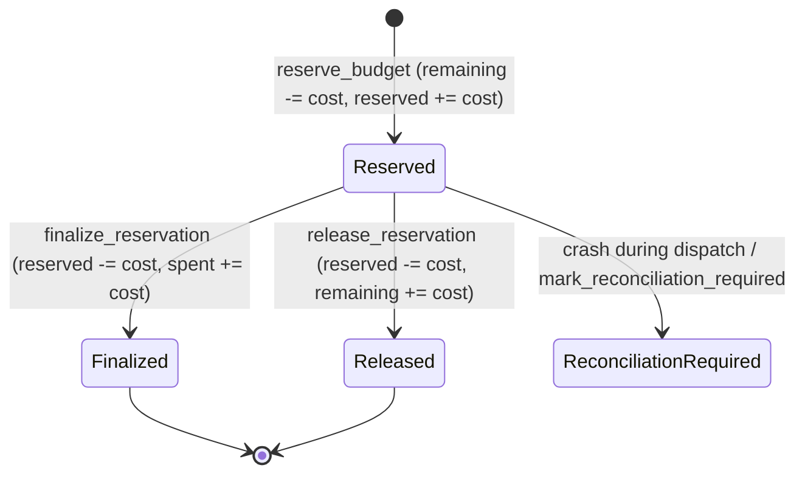

# SatsGrid — Phase 1B, Task 3: Persistent Session Budget Manager Implementation Report

**Status:** Complete  
**Date:** 2026-11-05  
**Scope:** Phase 1B, Task 3 only (Persistent Session Budget Manager)  
**Target Repository:** `/home/mobile_dev/Desktop/Ucee/BossBattle/satsgrid`

---

## 1. Executive Summary

Task 3 replaces volatile in-memory session budget accounting with a durable, SQLite-backed session accounting foundation. All session creation, initial funding, reservations, debits, releases, and financial history are persisted to SQLite under strict transaction control while maintaining full backwards compatibility with existing L402 session credentials, macaroons, caveats, CLI commands, and API endpoints.

### Key Highlights:
1. **Durable Schema:** Implemented Migration 3 defining `sessions`, `session_reservations`, and `accounting_entries` with strict check constraints enforcing balance non-negativity and budget sum conservation (`remaining_sats + reserved_sats + spent_sats = total_budget_sats`).
2. **Two-Phase Reservation & Concurrency Control:** Implemented atomic budget reservations using `BEGIN IMMEDIATE` transactions to prevent SQLite lock escalation under high multi-connection concurrency.
3. **Append-Only Financial Event Ledger:** Modeled the append-only event stream recording `session_funding`, `session_reservation`, `session_debit`, `session_reservation_release`, and `recovery_adjustment` events with unique UUIDs.
4. **Idempotent Operations:** Implemented conditional status checks (`WHERE id = ? AND status = 'reserved'`) guaranteeing that duplicate finalizations or releases fail fast without double-charging or double-crediting balances.
5. **Evidence-Grounded Crash Recovery:** Startup recovery releases only reservations proven not to have been dispatched, while ambiguous in-flight executions are marked `reconciliation_required` without balance forfeiture.
6. **Full Backwards Compatibility:** Preserved existing `SessionId` UUIDs, macaroon session caveats (`session`, `budget`, `capability`, `time <`), and direct `debit_session` fallback semantics.

---

## 2. Existing Session Behavior (As-Is vs. Replaced)

Prior to Task 3:
- **Session Creation & Funding:** `new_session` in [`src/node/api/handlers.rs`](file:///home/mobile_dev/Desktop/Ucee/BossBattle/satsgrid/src/node/api/handlers.rs) generated a UUID v4 `SessionId`, generated a Lightning invoice for the requested budget, and stored the session in an in-memory `HashMap<String, SessionBudget>` inside [`src/node/gate/budget.rs`](file:///home/mobile_dev/Desktop/Ucee/BossBattle/satsgrid/src/node/gate/budget.rs).
- **Volatile State:** `SessionBudget` tracked balances using an in-memory `Arc<AtomicU64>`. A server restart, crash, or deployment immediately wiped all session balances and credentials.
- **Macaroon Caveats:** The node minted an HMAC-SHA256 macaroon bound to the funding invoice hash containing caveats `session = <uuid>`, `budget = <sats>`, and `capability = inference`.
- **Debit Semantics:** On incoming inference requests with session caveats, `SessionBudgetManager::debit_session` deducted satoshis using CAS (`compare_exchange_weak`) on the in-memory atomic integer. There was no two-phase reservation or rollback capability if upstream inference failed.

With Task 3:
- The authoritative session balance is durable in SQLite `sessions`.
- The in-memory map acts as an ephemeral view synchronized with SQLite transactions, falling back to ephemeral mode only when the database is absent (e.g., in isolated unit tests).

---

## 3. Database Schema: Migration 0003

File: [`src/node/storage/migrations.rs`](file:///home/mobile_dev/Desktop/Ucee/BossBattle/satsgrid/src/node/storage/migrations.rs)

```sql
-- 1. SESSIONS: Durable session budgets and lifecycle
CREATE TABLE IF NOT EXISTS sessions (
    id TEXT PRIMARY KEY,
    payment_hash TEXT UNIQUE,
    total_budget_sats INTEGER NOT NULL CHECK (total_budget_sats >= 0),
    remaining_sats INTEGER NOT NULL CHECK (remaining_sats >= 0),
    reserved_sats INTEGER NOT NULL DEFAULT 0 CHECK (reserved_sats >= 0),
    spent_sats INTEGER NOT NULL DEFAULT 0 CHECK (spent_sats >= 0),
    status TEXT NOT NULL CHECK (status IN ('active', 'exhausted', 'expired', 'closed')),
    created_at INTEGER NOT NULL,
    expires_at INTEGER NOT NULL,
    updated_at INTEGER NOT NULL,
    CONSTRAINT chk_session_budget_sum CHECK (remaining_sats + reserved_sats + spent_sats = total_budget_sats)
);

CREATE INDEX IF NOT EXISTS idx_sessions_status ON sessions(status);
CREATE INDEX IF NOT EXISTS idx_sessions_expires_at ON sessions(expires_at);

-- 2. SESSION_RESERVATIONS: Two-phase reservation tracking
CREATE TABLE IF NOT EXISTS session_reservations (
    id TEXT PRIMARY KEY,
    session_id TEXT NOT NULL REFERENCES sessions(id) ON DELETE CASCADE,
    reserved_sats INTEGER NOT NULL CHECK (reserved_sats > 0),
    status TEXT NOT NULL CHECK (status IN ('reserved', 'finalized', 'released', 'reconciliation_required')),
    created_at INTEGER NOT NULL,
    finalized_at INTEGER,
    failure_reason TEXT
);

CREATE INDEX IF NOT EXISTS idx_session_reservations_session_id ON session_reservations(session_id);
CREATE INDEX IF NOT EXISTS idx_session_reservations_status ON session_reservations(status);

-- 3. ACCOUNTING_ENTRIES: Append-only financial event ledger
CREATE TABLE IF NOT EXISTS accounting_entries (
    id INTEGER PRIMARY KEY AUTOINCREMENT,
    entry_uuid TEXT NOT NULL UNIQUE,
    session_id TEXT REFERENCES sessions(id) ON DELETE CASCADE,
    reservation_id TEXT REFERENCES session_reservations(id) ON DELETE SET NULL,
    entry_type TEXT NOT NULL CHECK (entry_type IN ('session_funding', 'session_reservation', 'session_debit', 'session_reservation_release', 'recovery_adjustment')),
    amount_sats INTEGER NOT NULL CHECK (amount_sats >= 0),
    created_at INTEGER NOT NULL,
    description TEXT NOT NULL
);

CREATE INDEX IF NOT EXISTS idx_accounting_entries_session_id ON accounting_entries(session_id);
CREATE INDEX IF NOT EXISTS idx_accounting_entries_entry_uuid ON accounting_entries(entry_uuid);
```

### Constraints & Invariants Enforced:
- **`chk_session_budget_sum`**: Strictly enforces `remaining_sats + reserved_sats + spent_sats = total_budget_sats`. No satoshis can appear or disappear.
- **Uniqueness**: `sessions.id` is the primary key. `sessions.payment_hash` is unique, preventing duplicate funding.
- **Referential Integrity**: `session_reservations.session_id` and `accounting_entries.session_id` enforce foreign keys enabled via `PRAGMA foreign_keys = ON`.

---

## 4. Reservation Lifecycle & State Machine



### Lifecycle Primitives ([`src/node/storage/session.rs`](file:///home/mobile_dev/Desktop/Ucee/BossBattle/satsgrid/src/node/storage/session.rs)):
1. **`reserve_budget`**:
   - Acquires dedicated connection and executes `BEGIN IMMEDIATE`.
   - Verifies session exists, `status == 'active'`, `now <= expires_at`, and `remaining_sats >= cost`.
   - Decrements `remaining_sats`, increments `reserved_sats`. If `new_remaining == 0`, transitions status to `'exhausted'`.
   - Inserts row into `session_reservations` with `status = 'reserved'`.
   - Records `session_reservation` entry in `accounting_entries`.
   - Commits transaction.
2. **`finalize_reservation`**:
   - Executes `BEGIN IMMEDIATE`.
   - Asserts reservation exists with `status == 'reserved'`.
   - Updates `session_reservations.status = 'finalized'`.
   - Decrements `reserved_sats`, increments `spent_sats` in `sessions`.
   - Records `session_debit` in `accounting_entries`.
   - Commits transaction.
3. **`release_reservation`**:
   - Executes `BEGIN IMMEDIATE`.
   - Asserts reservation exists with `status == 'reserved'`.
   - Updates `session_reservations.status = 'released'` and records `failure_reason`.
   - Decrements `reserved_sats`, restores `remaining_sats`, sets session status back to `'active'`.
   - Records `session_reservation_release` in `accounting_entries`.
   - Commits transaction.
4. **`mark_reconciliation_required`**:
   - Transitions an ambiguous in-flight reservation to `'reconciliation_required'` without balance modification.

---

## 5. Session Compatibility & Backwards Compatibility

1. **Session Identifiers & Macaroons:**
   - Retained `SessionId(Uuid)` format matching macaroon caveat `session = <uuid>`.
   - Existing caveat extraction (`extract_session_caveats`) remains unchanged.
2. **Dual-Mode Adapter (`SessionBudgetManager`):**
   - Constructed with `SessionBudgetManager::with_store(db.session_store())`.
   - If SQLite store is configured: routes through durable transactions.
   - If store is omitted (legacy unit tests): falls back seamlessly to in-memory atomic CAS tracking.
3. **Direct `debit_session` Compatibility:**
   - For existing callers and integration tests invoking `debit_session(&session_id, cost)`, the manager executes an atomic reservation followed immediately by finalization in SQLite.

---

## 6. Crash Recovery & In-Flight State Resolution

File: [`src/node/storage/session.rs`](file:///home/mobile_dev/Desktop/Ucee/BossBattle/satsgrid/src/node/storage/session.rs) (`recover_in_flight_reservations`)

Following the principles established in Revision 3:
1. **Definitely Undispatched Reservations:**
   - Any reservation explicitly known not to have been dispatched to Ollama (provided via `definitely_undispatched_ids`) is safely released.
   - Restores `remaining_sats`, decrements `reserved_sats`, and records a release ledger entry.
2. **Ambiguous Reservations:**
   - All remaining reservations in `reserved` status on startup could have consumed GPU compute.
   - The recovery routine updates their status to `reconciliation_required` (`failure_reason: 'unresolved_crash_during_execution'`) while leaving `reserved_sats` intact.
   - Balances are **never** blindly restored without operator reconciliation.

---

## 7. Append-Only Financial Accounting Ledger

File: [`src/node/storage/session.rs`](file:///home/mobile_dev/Desktop/Ucee/BossBattle/satsgrid/src/node/storage/session.rs)

The `accounting_entries` table maintains an immutable audit stream of all financial actions:
- `session_funding`: Recorded when `new_session` establishes initial budget.
- `session_reservation`: Recorded when request reserves budget before inference.
- `session_debit`: Recorded when inference succeeds and reservation is finalized.
- `session_reservation_release`: Recorded when pre-generation failure releases reservation.
- `recovery_adjustment`: Recorded when operator reconciles ambiguous reservations.

Every entry includes:
- `entry_uuid`: Global UUID v4 reference preventing duplicate accounting.
- `session_id`: Associated session foreign key.
- `reservation_id`: Associated reservation foreign key (where applicable).
- `amount_sats`: Non-negative satoshi quantity.
- `created_at`: Unix epoch timestamp.
- `description`: Human-readable audit explanation.

---

## 8. Concurrency & High-Contention Verification

Under SQLite in WAL mode with connection pools, concurrent read-then-write transactions that start with standard deferred `BEGIN` can encounter `SQLITE_BUSY (code: 5) database is locked` due to lock escalation.

Task 3 explicitly implements `BEGIN IMMEDIATE` for all mutative session transactions (`reserve_budget`, `finalize_reservation`, `release_reservation`). This immediately acquires the reserved lock, serializing write transactions cleanly and relying on SQLite's 5,000ms `busy_timeout` queue.

### Verified in Integration Tests:
- `test_concurrent_reservations_multi_connection`: 10 parallel Tokio tasks on separate pool connections racing to reserve 100 sats each from a 1,000 sat budget. All 10 succeed, leaving remaining balance at 0 and reserved balance at 1,000.
- `test_concurrent_requests_exceeding_available_budget`: 10 parallel tasks racing to reserve 100 sats from a 500 sat budget. Exactly 5 succeed, and exactly 5 are rejected with `InsufficientBudget` / `Inactive(Exhausted)`.

---

## 9. Comprehensive Test Suite & Results

### Dedicated Test Suite: [`tests/session_persistence_tests.rs`](file:///home/mobile_dev/Desktop/Ucee/BossBattle/satsgrid/tests/session_persistence_tests.rs)

| # | Test Scenario | Description | Result |
|---|---|---|:---:|
| 1 | `test_session_creation_and_retrieval` | Validates session creation, balance fields, and initial funding ledger entry. | **PASS** |
| 2 | `test_session_persistence_across_reconnect` | Confirms session record survives connection pool closure and reopen from disk. | **PASS** |
| 3 | `test_session_persistence_across_node_reinitialization` | Confirms balances and debits persist across new manager instances. | **PASS** |
| 4 | `test_successful_budget_reservation` | Validates two-phase reservation, remaining decrement, and reserved increment. | **PASS** |
| 5 | `test_insufficient_budget_rejection` | Rejects reservation exceeding available remaining balance without mutating balances. | **PASS** |
| 6 | `test_expired_session_rejection` | Rejects reservation against expired session and marks session status as expired. | **PASS** |
| 7 | `test_concurrent_reservations_multi_connection` | Confirms multi-connection reservation concurrency with 10 parallel tasks. | **PASS** |
| 8 | `test_concurrent_requests_exceeding_available_budget` | Asserts exact quota enforcement under parallel race conditions. | **PASS** |
| 9 | `test_successful_reservation_finalization` | Confirms reservation finalization transitions to spent and records debit ledger entry. | **PASS** |
| 10 | `test_confirmed_failure_release` | Confirms pre-generation failure restores remaining balance and reactivates session. | **PASS** |
| 11 | `test_duplicate_finalization_rejection` | Rejects duplicate finalization attempts on already finalized reservations. | **PASS** |
| 12 | `test_duplicate_release_rejection` | Rejects duplicate release attempts on already released reservations. | **PASS** |
| 13 | `test_recovery_of_definitely_undispatched_reservations` | Validates startup recovery releases undispatched reservations safely. | **PASS** |
| 14 | `test_retention_of_ambiguous_reservations` | Asserts ambiguous in-flight reservations are retained as reconciliation_required. | **PASS** |
| 15 | `test_session_macaroon_compatibility` | Validates end-to-end macaroon minting, caveat parsing, and manager debit. | **PASS** |
| 16 | `test_existing_session_api_regression` | Full route test of `POST /v1/session/new` verifying challenge and DB entry. | **PASS** |

### Storage Schema Tests: [`tests/storage_tests.rs`](file:///home/mobile_dev/Desktop/Ucee/BossBattle/satsgrid/tests/storage_tests.rs)
- Added `test_migration_3_sessions_and_reservations_schema` validating the presence of `sessions`, `session_reservations`, and `accounting_entries`.

### Full Workspace Regression Verification:
- **`cargo check`**: Clean (exit code 0)
- **`cargo test --test session_persistence_tests`**: 16 passed, 0 failed
- **`cargo test --test storage_tests`**: 12 passed, 0 failed
- **`cargo test --test payment_authorization_tests`**: 7 passed, 0 failed
- **`cargo test --workspace`**: **136 passed, 0 failed across 20 integration test targets** (exit code 0)
- **`cargo fmt --all -- --check`**: Clean (exit code 0)
- **`cargo clippy --all-targets --all-features -- -D warnings`**: Clean (exit code 0)

---

## 10. Scope Boundaries Confirmation

- **Original repository untouched:** `/home/mobile_dev/Desktop/Ucee/BossBattle/nodus` remains completely untouched.
- **PayGuard:** Not implemented (deferred to Phase 2).
- **Hold Invoices:** Not implemented.
- **Complete inference request lifecycle:** Not implemented (deferred to Task 4).
- **Frontend / Nostr:** Unmodified.
- **Task 2 Replay Protection:** Maintained without regression (all 7 Task 2 tests passing).

---

## 11. Remaining Limitations & Recommended Next Task

### Remaining Limitations:
- The full request lifecycle state machine (`inference_requests` table tracking upstream execution from dispatch through Ollama completion and partial streaming failure) is deferred to Task 4.
- In `POST /v1/chat/completions`, session debits currently execute via the unified `debit_session` primitive (reservation + finalization). Task 4 will split this into pre-dispatch reservation and post-completion finalization/release around the proxy call.

### Recommended Next Task:
- **Phase 1B, Task 4: Request Lifecycle State Machine & Upstream Failure Rollbacks**
  - Implement `inference_requests` table.
  - Wire pre-dispatch session reservation before proxy call and post-execution finalization or confirmed-failure release after proxy response.

