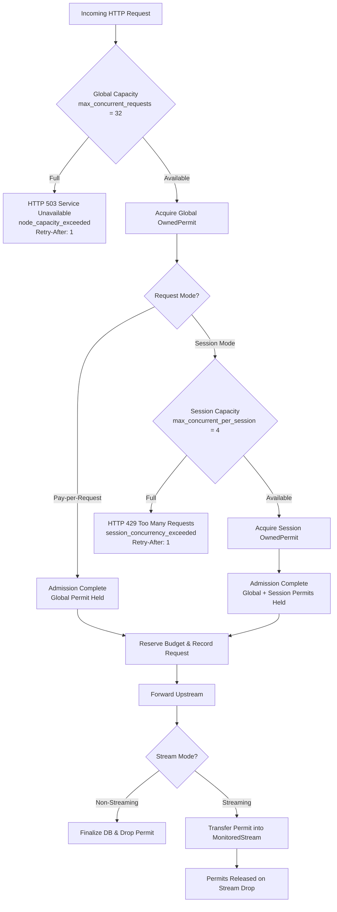

# Phase 2, Task 7: Global & Per-Session Concurrency Protection Implementation & Audit Report

## 1. Executive Summary

In Phase 2, Task 7, SatsGrid implemented process-level global and per-session concurrency protection to safeguard node resources and prevent noisy-neighbor session monopolization.

Prior to Task 7:
- Node operators had no process-level ceiling on concurrent in-flight inference requests forwarded to upstream inference backends (e.g., Ollama, vLLM).
- A single abusive or misconfigured session client could saturate all upstream queue slots and GPU compute capacity, causing denial of service for other paying users.
- Resource admission occurred after financial reservations, which risked unneeded lock contention or orphaned budget states under extreme overload.

Task 7 introduces an explicit, multi-tier admission barrier:
1. **Global Concurrency Semaphore**: Bounded by `max_concurrent_requests` (default: 32). Overload immediately yields `HTTP 503 Service Unavailable` with `Retry-After: 1` and code `node_capacity_exceeded`.
2. **Per-Session Semaphore Registry**: Bounded by `max_concurrent_per_session` (default: 4), keyed by durable `session_id`. Excess concurrency immediately yields `HTTP 429 Too Many Requests` with `Retry-After: 1` and code `session_concurrency_exceeded`.
3. **Fail-Fast by Default**: `admission_timeout_secs: 0` uses non-blocking `try_acquire_owned()`, shedding excess load with sub-millisecond response latency.
4. **Permit-to-Stream Handover**: The acquired RAII permits (`ConcurrencyPermit`) are held across the full request lifecycle. For SSE streaming responses, ownership is cleanly transferred into `MonitoredStream`, retaining capacity until natural completion, client disconnection, or timeout termination.
5. **Strict Financial Admission Ordering**: Concurrency admission occurs *before* session budget reservations and request row creation. If admission fails, no satoshis are locked and zero database writes occur.
6. **Task 7.5A/7.5B Hardening**: Idempotency key collisions during concurrent dispatches trigger structured SQLite error classification (`idempotency_key.is_some() && db_err.code() == 2067`) and immediate reservation rollback (`release_reservation`), preserving the conservation invariant `remaining + reserved + spent = total`.

All 197 workspace tests pass cleanly with zero warnings under Clippy and perfect formatting under rustfmt.

---

## 2. Architecture & Design Principles

### 2.1 Concurrency Admission Hierarchy

The concurrency subsystem is implemented in `src/node/concurrency.rs` via `ConcurrencyManager` and `SessionConcurrencyRegistry`:



### 2.2 Component Specifications

#### Global Semaphore
- Uses `tokio::sync::Semaphore` wrapped in an `Arc`.
- Initialized from `Config::concurrency.max_concurrent_requests` (default: 32).
- When permits are exhausted, returns `Error::ServerOverloaded`.

#### Per-Session Registry
- Implemented as `SessionConcurrencyRegistry` holding a `parking_lot::Mutex<HashMap<String, Arc<SessionSemaphoreEntry>>>`.
- Each entry tracks an `Arc<Semaphore>` initialized to `max_concurrent_per_session` (default: 4), the active lease count, and a last-active timestamp `last_active_at`.
- Active leases hold a `SessionPermitLease` RAII guard. When the lease drops, it decrements the lease count and touches `last_active_at`.
- Garbage collection (`prune_idle_sessions`) purges entries where `active_leases == 0` and idle duration exceeds the eviction threshold (default: 300s).

#### Combined Permit Container (`ConcurrencyPermit`)
- Bundles `_global: Option<OwnedSemaphorePermit>` and `_session: Option<SessionPermitLease>`.
- Dropping `ConcurrencyPermit` automatically releases both the global capacity slot and the session slot back to their respective semaphores.

---

## 3. Configuration & Validation

In `src/config/schema.rs`, `ConcurrencyConfig` defines operator-tunable parameters:

| Parameter | Type | Default | Validation Rules | Description |
|---|---|---|---|---|
| `max_concurrent_requests` | `usize` | `32` | `> 0` | Total global concurrent inference requests. |
| `max_concurrent_per_session` | `usize` | `4` | `> 0`, `<= max_concurrent_requests` | Max concurrent inference requests per session ID. |
| `admission_timeout_secs` | `u64` | `0` | None | Queue wait timeout. `0` = fail-fast (non-blocking). |
| `session_idle_eviction_secs` | `u64` | `300` | None | Inactivity window before idle session semaphores are evicted. |

Validation is strictly enforced during node startup (`validate()`):
- `max_concurrent_requests == 0` fails with `ConfigValidationError`.
- `max_concurrent_per_session == 0` fails with `ConfigValidationError`.
- `max_concurrent_per_session > max_concurrent_requests` fails with `ConfigValidationError`.

---

## 4. HTTP Status & Error Protocols

All capacity rejections follow standard RFC protocols and OpenAI error formats:

### Global Overload: HTTP 503
- **HTTP Status**: `503 Service Unavailable`
- **Headers**: `Retry-After: 1`
- **Body**:
  ```json
  {
    "error": {
      "message": "Node capacity exceeded. Please retry shortly.",
      "type": "server_overload",
      "param": null,
      "code": "node_capacity_exceeded"
    }
  }
  ```

### Session Limit Exceeded: HTTP 429
- **HTTP Status**: `429 Too Many Requests`
- **Headers**: `Retry-After: 1`
- **Body**:
  ```json
  {
    "error": {
      "message": "Session concurrency limit exceeded. Wait for existing requests to finish.",
      "type": "rate_limit_error",
      "param": null,
      "code": "session_concurrency_exceeded"
    }
  }
  ```

---

## 5. Streaming Permit Lifecycle & Transfer

To prevent stream starvation and capacity exhaustion during Server-Sent Events (SSE):

1. **Permit Ownership in Handlers**:
   - The handler acquires `ConcurrencyPermit` before invoking `proxy_chat_completions`.
   - For non-streaming requests, `ConcurrencyPermit` remains in handler scope and drops upon handler return (after database finalization).
2. **Single Transfer to `MonitoredStream`**:
   - For streaming requests (`stream: true`), `proxy_chat_completions_stream` constructs a `MonitoredStream`.
   - `concurrency_permit` is passed by value and stored as `_concurrency_permit: Option<ConcurrencyPermit>` inside `MonitoredStream`.
   - Exactly one transfer occurs; no permits are cloned or converted to shared references.
3. **Deterministic Stream Drop**:
   - Axum's `Body::from_stream` consumes `MonitoredStream`.
   - `MonitoredStream` drops under all exit conditions:
     - **Natural completion**: Stream emits `None` / closes; Axum drops the stream body immediately.
     - **Upstream error**: Upstream returns an error or socket closes early.
     - **Client disconnect**: Client closes TCP connection; Axum drops the response body.
     - **Idle / Total timeout**: Internal timeout timers trigger stream abort; stream is dropped.
   - Upon drop, `ConcurrencyPermit`'s RAII drop implementation returns permits to the global semaphore and decrements the active session lease count.

---

## 6. Financial Invariants & Rollback Mechanics

### Invariant 1: Admission Precedes Financial Reservation
No financial reservation (`reserve_budget`) or database record (`create_request`) is executed until both global and session concurrency permits are successfully acquired. If a request is rejected with 503 or 429, zero satoshis are locked.

### Invariant 2: Simultaneous Idempotency Race Rollback (Task 7.5A & 7.5B)
If two concurrent requests present the same `(session_id, idempotency_key)`:
1. Both may pass the initial lookup and acquire concurrency permits.
2. Both reserve session budget (`reserve_budget`).
3. The first request successfully inserts `inference_requests`.
4. The second request collides on the database unique index `idx_inference_requests_session_idempotency`.
5. In `src/node/storage/request.rs`, structured error classification confirms the collision:
   ```rust
   if idempotency_key.is_some() && db_err.code().as_deref() == Some("2067") {
       return Err(Error::VerificationFailed(
           "A request with this idempotency key is currently in flight".to_string(),
       ));
   }
   ```
6. The handler catches this error and immediately calls:
   ```rust
   budget_manager.release_reservation(&res_id, "request_creation_failed").await?;
   ```
7. Result: The losing request's reserved sats are immediately restored to the session's remaining balance. The session accounting invariant `remaining + reserved + spent = total` is strictly maintained.

---

## 7. Process-Local Scope & Multi-Process Limitations

> [!NOTE]
> `ConcurrencyManager` is an in-memory, process-local coordination structure utilizing Tokio semaphores and parking_lot mutexes.

- **Process-Local Operation**: In single-binary deployments (the standard SatsGrid operational model), all requests pass through the single `ConcurrencyManager`, providing exact, zero-overhead concurrency enforcement.
- **Multi-Process Scaling Boundary**: If multiple SatsGrid node processes run concurrently against a shared database or load balancer, in-memory semaphores are not shared across processes. Multi-process concurrency limits must be enforced via an upstream reverse proxy (e.g. NGINX, Envoy) or a shared coordination tier (e.g. Redis).

---

## 8. Verification & Test Suite Matrix

The concurrency subsystem is verified by comprehensive unit and integration tests across 11 test suites (197 tests total):

| Test Suite / File | Test Name | Invariant / Scenario Tested |
|---|---|---|
| `tests/concurrency_admission_tests.rs` | `test_global_concurrency_limit_exhaustion` | Global limit returns HTTP 503 with Retry-After: 1 and node_capacity_exceeded. |
| `tests/concurrency_admission_tests.rs` | `test_session_concurrency_limit_exhaustion` | Session limit returns HTTP 429 with Retry-After: 1 and session_concurrency_exceeded. |
| `tests/concurrency_admission_tests.rs` | `test_per_request_ignores_session_concurrency` | Pay-per-request calls acquire global permits without session limits. |
| `tests/concurrency_admission_tests.rs` | `test_concurrency_permits_released_after_non_streaming_completion` | Permits are immediately released when non-streaming response finishes. |
| `tests/concurrency_admission_tests.rs` | `test_concurrency_permits_held_during_streaming_and_released_on_drop` | Permits remain held across active SSE streaming and release on client drop. |
| `tests/concurrency_admission_tests.rs` | `test_fail_fast_admission_under_zero_timeout` | Non-blocking admission rejects immediately under zero timeout. |
| `tests/concurrency_admission_tests.rs` | `test_concurrent_idempotency_race_rolls_back_reservation` | Simultaneous idempotency collision rolls back budget reservation and preserves balance. |
| `tests/concurrency_admission_tests.rs` | `test_primary_key_collision_classified_as_internal_error` | PK collision (error 1555) returns Error::Internal, not idempotency error. |
| `tests/concurrency_admission_tests.rs` | `test_null_idempotency_key_unique_collision_classified_as_internal_error` | Non-idempotent unique collisions return Error::Internal. |
| `tests/concurrency_admission_tests.rs` | `test_session_registry_prunes_idle_entries` | Idle session entries are correctly pruned without affecting active leases. |
| `tests/request_lifecycle_tests.rs` | `test_streaming_request_with_session_budget` | Full SSE streaming lifecycle with session reservation and finalization. |
| `tests/request_lifecycle_tests.rs` | `test_idempotency_key_prevents_duplicate_processing` | Duplicate idempotency key rejects duplicate execution. |
| `tests/timeout_cancellation_tests.rs` | `test_stream_idle_timeout_terminates_stream` | Stalled SSE streams terminate via idle timeout and release resources. |
| `tests/session_persistence_tests.rs` | `test_concurrent_reservations_respect_total_budget` | Multi-threaded concurrent reservations preserve exact balance conservation. |
| `src/node/concurrency.rs` (unit) | `test_concurrency_manager_global_limit` | Unit test of global semaphore acquisition and exhaustion. |
| `src/node/concurrency.rs` (unit) | `test_session_concurrency_limit` | Unit test of per-session semaphore acquisition and isolation. |
| `src/node/concurrency.rs` (unit) | `test_session_idle_pruning` | Unit test of session entry last_active eviction logic. |
