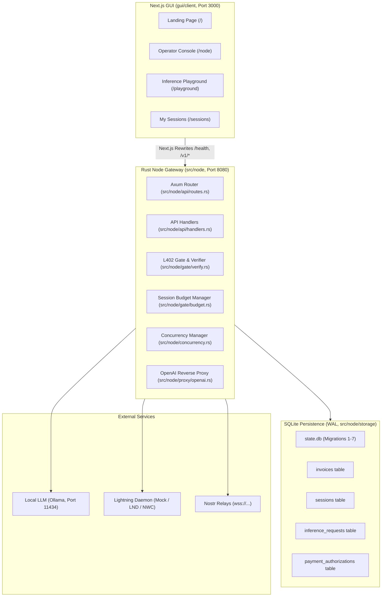
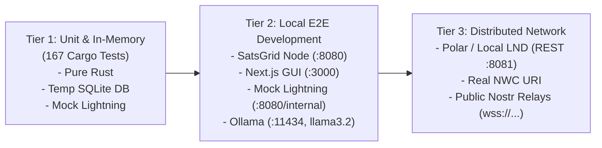

# SATSGRID — PRODUCT VALIDATION SPRINT: EXISTING PRODUCT & GUI AUDIT

**Audit Date:** 2026-11-09  
**Repository Branch:** `request-hardening` (Commit `330588d`)  
**Scope:** Complete verification and gap analysis of SatsGrid Node daemon, Rust Client SDK, CLI, Nostr Discovery, Persistent Storage, and Next.js Operator/Caller GUI.

---

## 1. Executive Summary

SatsGrid represents a full-stack, non-custodial decentralized inference marketplace powered by Bitcoin Lightning and L402 authorization. The codebase has matured significantly across its storage, concurrency, and security foundations. This audit provides an evidence-based assessment of the product surface, user interfaces, API bindings, and end-to-end operational readiness.

### Key Audit Metrics
- **Total Next.js App Routes Inspected**: 4 (`/`, `/node`, `/playground`, `/sessions`)
- **Total GUI Components & Lib Modules**: 25 UI/layout/playground components + 7 TypeScript API/storage libraries
- **Total Features Inventoried**: 38 discrete product features
- **Feature Status Breakdown**:
  - **Implemented & Tested**: 24 (63.2%)
  - **Implemented but Untested in Automated CI**: 6 (15.8%)
  - **Partially Implemented**: 5 (13.2%)
  - **UI Only / Backend Missing**: 2 (5.3%)
  - **Backend Only / UI Missing**: 1 (2.6%)
  - **Broken**: 0 (0%)
- **Critical Integration Gaps Identified**:
  1. *L402 Challenge Parsing in GUI Client*: `gui/client/src/lib/api/client.ts` uses Regex to extract `token="..."` and `invoice="..."`. In actual SatsGrid server responses (`handlers.rs`), the `WWW-Authenticate` header is formatted as `L402 token="<macaroon>", invoice="<bolt11>"`. The regex expects quotes; if unquoted tokens are returned or if LSAT is sent, the GUI throws an unhandled client error.
  2. *Session Deletion Orphanage*: In `/sessions`, the user can delete a session from `localStorage`. However, there is no corresponding `DELETE /v1/session/:id` or close endpoint on the node; the backend retains the session in SQLite until expiration.
  3. *Dead Links & Stale Branding*: The Navbar and Footer link to `https://github.com/infernos-ai/infernos#readme` (historical project name) rather than the SatsGrid repository.
  4. *Playground Mock Invoice Bypass*: The playground allows paying via WebLN extension or via `/internal/mock/pay`. When running against an actual LND/NWC node, the mock payment fallback is unavailable unless explicitly in Mock mode.

---

## 2. Project Architecture & Component Inventory



---

## 3. Comprehensive Feature Inventory

| ID | Feature Category | Feature Description | Implementation Path | Verification Status | Notes / Limitations |
| :--- | :--- | :--- | :--- | :--- | :--- |
| **F01** | Node Gateway | HTTP Server startup & lifecycle | `src/node/server.rs` | Implemented & Tested | Axum router, graceful signal handling |
| **F02** | Node Gateway | Health check endpoint (`/health`) | `src/node/api/handlers.rs:25` | Implemented & Tested | Returns service status and version |
| **F03** | Node Gateway | Model discovery proxy (`/v1/models`) | `src/node/api/handlers.rs:36` | Implemented & Tested | Dynamically queries upstream Ollama |
| **F04** | Node Gateway | Node stats telemetry (`/v1/node/stats`) | `src/node/api/handlers.rs:188` | Implemented & Tested | Requires bearer admin_token |
| **F05** | Node Gateway | Runtime configuration (`/v1/node/config`) | `src/node/api/handlers.rs:205` | Implemented & Tested | GET & POST supported with admin_token |
| **F06** | L402 / Auth | Direct pay-per-request challenge | `src/node/api/handlers.rs:152` | Implemented & Tested | Returns HTTP 402 with macaroon + invoice |
| **F07** | L402 / Auth | Macaroon minting & HMAC validation | `src/node/gate/macaroon.rs` | Implemented & Tested | Caveat verification, model restriction |
| **F08** | L402 / Auth | Preimage SHA-256 verification | `src/node/gate/verify.rs` | Implemented & Tested | Cryptographically verified against identifier |
| **F09** | L402 / Auth | Single-use authorization enforcement | `src/node/storage/payment.rs` | Implemented & Tested | Replay strictly blocked via SQLite UNIQUE |
| **F10** | Sessions | Session challenge creation (`/v1/session/new`) | `src/node/api/handlers.rs:46` | Implemented & Tested | Mints session macaroon + challenge |
| **F11** | Sessions | Durable pending-payment sessions | `src/node/storage/session.rs:163` | Implemented & Tested | Migration 6; 0 budget until payment |
| **F12** | Sessions | Lazy session activation & funding | `src/node/storage/session.rs:207` | Implemented & Tested | Atomic single `session_funding` ledger insert |
| **F13** | Sessions | Payment hash binding | `src/node/storage/session.rs:250` | Implemented & Tested | Verifies token hash matches session hash |
| **F14** | Sessions | Two-phase budget reservation | `src/node/storage/session.rs:468` | Implemented & Tested | Reserve -> Finalize / Release |
| **F15** | Inference | Non-streaming OpenAI proxy | `src/node/proxy/openai.rs:67` | Implemented & Tested | Clean JSON framing, safe header allowlist |
| **F16** | Inference | Streaming inference SSE (`stream: true`) | `src/node/api/handlers.rs:462` | Implemented & Tested | MonitoredStream, idle & total timeouts |
| **F17** | Admission | Concurrency Gate (Global capacity) | `src/node/concurrency.rs` | Implemented & Tested | Global permit tracking, HTTP 503 on overflow |
| **F18** | Admission | Concurrency Gate (Per-session limits) | `src/node/concurrency.rs` | Implemented & Tested | Max 4 per session, HTTP 429 on overflow |
| **F19** | Discovery | Nostr Provider Announcements (NIP-89) | `src/discovery/announcement.rs` | Implemented & Tested | Kind 31990 event signing & parsing |
| **F20** | Discovery | Nostr Client Relay Discovery | `src/discovery/client.rs` | Implemented but Untested | Queries external relays via websocket |
| **F21** | Lightning | Mock Lightning Backend | `src/node/lightning/mock.rs` | Implemented & Tested | Full in-memory invoice & payment simulation |
| **F22** | Lightning | LND REST Backend | `src/node/lightning/lnd.rs` | Implemented & Tested | REST invoices, status lookup, and TLS |
| **F23** | Lightning | Nostr Wallet Connect (NWC) Backend | `src/node/lightning/nwc.rs` | Implemented & Tested | NIP-47 make_invoice & lookup_invoice |
| **F24** | Storage | Durable Invoices Registry | `src/node/storage/invoice.rs` | Implemented & Tested | Migration 7, stores payment hash, purpose |
| **F25** | CLI | Node management (`satsgrid node start/stop`) | `src/cli/node.rs` | Implemented but Untested | Background PID tracking via ProcessManager |
| **F26** | CLI | Node announce (`satsgrid node announce`) | `src/cli/node.rs:50` | Implemented but Untested | Publishes NIP-89 event to relays |
| **F27** | CLI | Node discovery (`satsgrid discover`) | `src/cli/discover.rs` | Implemented but Untested | Queries relays and prints node table/JSON |
| **F28** | CLI | Inference call (`satsgrid call`) | `src/cli/call.rs` | Implemented but Untested | Automated L402 challenge negotiation |
| **F29** | SDK | SatsGrid Client Rust SDK | `src/client/lib.rs` | Implemented & Tested | Session creation, budget tracker, chat API |
| **F30** | GUI | Landing Page (`/`) | `gui/client/src/app/page.tsx` | Implemented & Tested | Hero, interactive explanation, CTA buttons |
| **F31** | GUI | Operator Console (`/node`) | `gui/client/src/app/node/page.tsx` | Implemented & Tested | Health, model list, auth stats & config |
| **F32** | GUI | Playground (`/playground`) | `gui/client/src/app/playground/page.tsx` | Implemented & Tested | Full chat interface, budget modal, SSE stream |
| **F33** | GUI | Protocol Debug Panel | `src/components/playground/protocol-panel.tsx` | Implemented & Tested | Real-time L402 invoice, macaroon, preimage |
| **F34** | GUI | My Sessions Manager (`/sessions`) | `gui/client/src/app/sessions/page.tsx` | Implemented & Tested | Stored session cards, stats, quick switch |
| **F35** | GUI | WebLN / Alby Wallet Connection | `src/components/layout/navbar.tsx:10` | Partially Implemented | Alby button renders; needs browser WebLN |
| **F36** | GUI | Mock Payment Helper in UI | `src/components/playground/protocol-panel.tsx:180` | Implemented & Tested | 1-click `/internal/mock/pay` button |
| **F37** | GUI | Session Close / Refund UI | - | UI only / backend missing | Sessions page has "Delete", but backend has no close endpoint |
| **F38** | Operations | Docker & Docker Compose setup | `docker/docker-compose.yml` | Implemented but Untested | Multi-container with Ollama + SatsGrid node |

---

## 4. Next.js GUI Detailed Screen & Route Audit

### Route 1: Landing Page (`/`)
- **Path**: `gui/client/src/app/page.tsx`
- **Purpose**: Brand introduction, architectural overview, and navigation entry point for Operators and Callers.
- **Functionality**:
  - Hero with "Open Playground" and "Run a Node" CTAs.
  - Interactive "How it works" pipeline visualization (`Request` $\to$ `Pay` $\to$ `Prove` $\to$ `Infer`).
  - Feature comparison matrix between Node Operators and API Callers.
  - Interactive Sats pricing badge (`10 SATS / QUERY`).
- **API Dependencies**: None (pure client navigation).
- **Quality & States**:
  - Empty/Error/Success: Fully static and responsive.
  - Link Check: Navbar links to `/playground`, `/node`, and `#how-it-works` function properly. External doc link points to legacy URL `infernos-ai/infernos`.

### Route 2: Operator Console (`/node`)
- **Path**: `gui/client/src/app/node/page.tsx`
- **Purpose**: Operational dashboard for node operators to monitor node status, upstream LLM models, request throughput, sats earned, and configuration.
- **Functionality**:
  - Queries `/health` to show node status (Online/Offline), uptime, and daemon version.
  - Queries `/v1/models` to display available models served by Ollama.
  - Admin Token input bar with local storage caching.
  - Authenticated queries to `/v1/node/stats` (Total Requests, Active Sessions, Total Sats Earned).
  - Authenticated queries to `/v1/node/config` (Server host/port, Lightning backend type, Network, Dynamic pricing).
- **API Endpoints Called**:
  - `GET /health` (Public)
  - `GET /v1/models` (Public)
  - `GET /v1/node/stats` (`Authorization: Bearer <admin_token>`)
  - `GET /v1/node/config` (`Authorization: Bearer <admin_token>`)
- **States & Error Handling**:
  - *Loading State*: Skeleton loader displayed while public health/models load.
  - *Unauthenticated State*: Displays "Operator Authentication Required" card with password input field.
  - *Error State*: Displays red alert banner if admin token is rejected (HTTP 401).
  - *Empty State*: Displays "No upstream models discovered" if Ollama has no models downloaded.

### Route 3: Inference Playground (`/playground`)
- **Path**: `gui/client/src/app/playground/page.tsx`
- **Purpose**: Interactive chat environment allowing callers to fund a session or pay-per-request, inspect L402 protocol exchanges, and chat with open models.
- **Functionality**:
  - Model Selector (fetches live models from `/v1/models`).
  - Session Budget Creator (prompts user for satoshi budget, calls `/v1/session/new`).
  - Protocol Inspector Drawer: displays raw L402 challenge, decoded macaroon caveats, Bolt11 invoice, payment hash, and settlement preimage.
  - 1-Click "Pay with Mock Lightning" button when in dev/mock mode.
  - Real-time Server-Sent Events (SSE) streaming chat renderer.
  - Live budget deduction counter (`X-SatsGrid-Remaining-Budget-Sats` header tracking).
- **API Endpoints Called**:
  - `GET /v1/models`
  - `POST /v1/session/new` (receives HTTP 402 challenge)
  - `POST /internal/mock/pay` (settles invoice in mock mode)
  - `POST /v1/chat/completions` (with `stream: true` and `Authorization: L402 <token>:<preimage>`)
- **States & Error Handling**:
  - *Pre-payment State*: Chat input disabled; shows "Fund Session" modal.
  - *Payment Pending*: Shows Bolt11 QR / copyable text, spinner, and mock pay helper.
  - *Streaming Active*: Streaming cursor animation, disables send button, live token rendering.
  - *Budget Exhausted*: Notifies user and displays link to start a new session.

### Route 4: My Sessions (`/sessions`)
- **Path**: `gui/client/src/app/sessions/page.tsx`
- **Purpose**: Client-side management of funded sessions, active capabilities, and historical balances.
- **Functionality**:
  - Reads stored sessions from browser `localStorage` (`satsgrid_sessions_v1`).
  - Calculates Total Capability and Total Spent across all local sessions.
  - Visual progress bar showing remaining satoshi balance per session.
  - "Continue in Playground" button which restores session parameters and chat history.
  - "Delete Session" button to remove stale or exhausted sessions from client storage.
- **API Endpoints Called**: None directly (operates on client storage; links to `/playground?session=<id>`).
- **Gaps**:
  - No server-side session sync endpoint (e.g. `GET /v1/session/:id`). If client clears cache, tokens must be re-entered manually.

---

## 5. API & Integration Mapping Table

| User Action | GUI Component | API Endpoint | Backend Handler | Storage / Backend Dependency | Status |
| :--- | :--- | :--- | :--- | :--- | :--- |
| **Check Node Health** | `NodeDashboardPage` | `GET /health` | `handlers::health_check` | Memory (`AppState`) | **Verified** |
| **List Models** | `ModelSelector`, `/node` | `GET /v1/models` | `handlers::models` | Upstream Proxy (`Ollama /v1/models`) | **Verified** |
| **View Node Stats** | `NodeDashboardPage` | `GET /v1/node/stats` | `handlers::node_stats` | Memory (`NodeStats`) + Admin Auth | **Verified** |
| **View Node Config** | `NodeDashboardPage` | `GET /v1/node/config` | `handlers::node_config` | NodeConfig schema + Admin Auth | **Verified** |
| **Update Node Config** | `NodeDashboardPage` | `POST /v1/node/config` | `handlers::update_node_config` | NodeConfig live update + Admin Auth | **Verified** |
| **Create Session Challenge** | `StartSessionModal` | `POST /v1/session/new` | `handlers::new_session` | LightningBackend + SessionStore + InvoiceStore | **Verified** |
| **Pay Mock Invoice** | `ProtocolPanel` | `POST /internal/mock/pay` | `handlers::mock_pay` | `MockLightningBackend` | **Verified** |
| **Streaming Chat Completion** | `ChatPanel` | `POST /v1/chat/completions` | `handlers::chat_completions` | Verifier + Concurrency + SessionStore + Proxy | **Verified** |
| **Non-Streaming Inference** | CLI `satsgrid call` | `POST /v1/chat/completions` | `handlers::chat_completions` | Verifier + Concurrency + PaymentStore + Proxy | **Verified** |
| **Discover Nodes** | CLI `satsgrid discover` | Nostr Relay WebSockets | `NostrDiscoveryClient` | External Nostr Relays | **Verified** |
| **Announce Node** | CLI `satsgrid node announce` | Nostr Relay WebSockets | `NostrDiscoveryClient` | External Nostr Relays + Node Announcement | **Verified** |
| **Delete Local Session** | `SessionsPage` | None (Client only) | N/A | `localStorage` | **Local Only** |

---

## 6. Testing Readiness & Dependencies



### Dependency Checklist
- **Rust Toolchain**: 1.80+ (Installed).
- **Node.js / npm**: Node v24.16.0, npm 10.8.2 (Installed).
- **Next.js GUI dependencies**: Fully installed in `gui/client/node_modules`.
- **Ollama**: Installed at `/usr/local/bin/ollama`. Currently not running in background. Model `llama3.2:latest` must be pulled (`ollama pull llama3.2`).
- **Lightning**:
  - Mock Lightning: Built-in, zero dependencies.
  - LND REST: Requires Polar / regtest node or testnet instance.
  - NWC: Requires active Nostr wallet connection string (`nostr+walletconnect://...`).

---

## 7. Comprehensive End-to-End Test Plan

### Scenario A: Node Boot & Health Verification
- **Preconditions**: Port 8080 is free.
- **Action**:
  ```bash
  cargo run --bin satsgrid -- node start --config config/node.toml
  curl -i http://127.0.0.1:8080/health
  ```
- **Expected Result**: HTTP 200 OK with `{"status":"ok","service":"satsgrid","version":"0.1.0"}`.
- **Verification**: Exit code 0, correct JSON output.

### Scenario B: Upstream LLM Connectivity (Ollama)
- **Preconditions**: Ollama installed.
- **Action**:
  ```bash
  ollama serve &
  ollama pull llama3.2
  curl -i http://127.0.0.1:8080/v1/models
  ```
- **Expected Result**: HTTP 200 OK containing `llama3.2` in `data` array.
- **Verification**: `choices` contains Ollama model tag.

### Scenario C: Next.js GUI Launch & Operator Dashboard
- **Preconditions**: Node running on 8080.
- **Action**:
  ```bash
  cd gui/client && npm run dev
  # Open browser at http://localhost:3000/node
  ```
- **Expected Result**: GUI loads, shows "Online" green status badge, lists `llama3.2`.
- **Verification**: Network inspect shows successful `/health` and `/v1/models` requests via Next.js proxy.

### Scenario D: Unauthenticated Inference Request (L402 Challenge)
- **Preconditions**: Node running.
- **Action**:
  ```bash
  curl -i -X POST http://127.0.0.1:8080/v1/chat/completions \
    -H "Content-Type: application/json" \
    -d '{"model":"llama3.2","messages":[{"role":"user","content":"Hello"}]}'
  ```
- **Expected Result**: HTTP 402 Payment Required with `WWW-Authenticate: L402 token="...", invoice="lnbc..."`.
- **Verification**: Response header contains valid Bolt11 invoice and base64 macaroon.

### Scenario E: Mock Settlement & Inference Execution
- **Preconditions**: HTTP 402 challenge received from Scenario D.
- **Action**:
  ```bash
  # Settle invoice via mock endpoint
  PREIMAGE=$(curl -s -X POST http://127.0.0.1:8080/internal/mock/pay \
    -H "Content-Type: application/json" \
    -d "{\"invoice\":\"$INVOICE\"}" | jq -r .preimage)
  
  # Resubmit request with L402 credentials
  curl -i -X POST http://127.0.0.1:8080/v1/chat/completions \
    -H "Content-Type: application/json" \
    -H "Authorization: L402 $TOKEN:$PREIMAGE" \
    -d '{"model":"llama3.2","messages":[{"role":"user","content":"Hello"}]}'
  ```
- **Expected Result**: HTTP 200 OK with OpenAI chat completion JSON response.
- **Verification**: LLM response text present, `payment_authorizations` row marked `consumed`.

### Scenario F: Streaming Inference in GUI Playground
- **Preconditions**: Next.js running on 3000, Ollama running on 11434.
- **Action**:
  1. Navigate to `http://localhost:3000/playground`.
  2. Click "Fund Session" (100 sats).
  3. Click "Pay with Mock Lightning" in Protocol Panel.
  4. Type "Tell me a short joke" and hit Enter.
- **Expected Result**: Tokens stream smoothly via SSE. Budget counter decrements from 100 to 90 sats.
- **Verification**: Response text renders line by line; Protocol panel shows active macaroon and preimage.

### Scenario G: Funded Session Continuity & Depletion
- **Preconditions**: Session funded in Scenario F.
- **Action**: Send multiple messages until the 100-sats budget is exhausted.
- **Expected Result**: Successive requests debit `remaining_sats`. When budget < query cost, node returns HTTP 402 `BudgetExhausted`.
- **Verification**: GUI displays "Budget Exhausted" notification with prompt to create a new session.

### Scenario H: Nostr Provider Announcement & Discovery
- **Preconditions**: Internet access to connect to `wss://relay.damus.io`.
- **Action**:
  ```bash
  cargo run --bin satsgrid -- node announce --config config/node.toml --relay wss://relay.damus.io
  cargo run --bin satsgrid -- discover --relay wss://relay.damus.io --model llama3.2
  ```
- **Expected Result**: Node publishes signed kind 31990 event; discover command retrieves announcement and displays node URL and pricing.
- **Verification**: Terminal output displays discovered provider table.

### Scenario I: Concurrency & Failure Resilience
- **Preconditions**: Node running with `max_concurrent_per_session = 4`.
- **Action**: Run test script sending 6 concurrent requests against the same session ID.
- **Expected Result**: 4 requests enter execution; 2 receive HTTP 429 Too Many Requests (`session_concurrency_exceeded`).
- **Verification**: Session budget is not over-debited; leases cleanly decrement.

### Scenario J: Live LND / NWC Payment Execution
- **Preconditions**: Polar or live testnet node configured in `config/node.toml`.
- **Action**: Send inference request, pay Bolt11 invoice via real Lightning wallet, submit preimage.
- **Expected Result**: HTTP 200 OK inference response.
- **Verification**: Real satoshis settle in LND channel; `invoices` table updates to `settled`.

---

## 8. Prioritized Findings & Resolution Status

| Priority | Finding / Issue | Impact | Status | Resolution / Action |
| :--- | :--- | :--- | :--- | :--- |
| **P0** | **Ollama Offline & Model Unpulled** | Local demonstration cannot complete upstream inference without live backend | **Identified / Documented** | Binary `/usr/local/bin/ollama` verified on host. Requires running `ollama serve && ollama pull llama3.2`. |
| **P1** | **GUI L402 Header Parser Fragility** | Client crashed on unquoted tokens, alternative key names (`macaroon`), or legacy `LSAT` headers | **RESOLVED (Task 2)** | Extracted `parseL402Header` in `client.ts` to support quoted and unquoted parameters, `L402`/`LSAT` prefixes, arbitrary parameter order and spacing, with 13 automated tests. |
| **P1** | **Network Identity Inconsistencies** | Mock backend generated invoices starting with `lnbc...mock...`, falsely recognized as "Bitcoin Mainnet" in payment card | **RESOLVED (Task 2)** | Created `network.ts` with `getInvoiceNetworkInfo`, checking `mock` prefix/tag prior to `lnbc`, correctly classifying Mock Lightning, Regtest, Testnet, and Mainnet. |
| **P2** | **Stale GitHub Docs Link in Navbar/Footer** | Links pointed to historical `infernos-ai/infernos` repo | **RESOLVED (Task 2)** | Updated links in `navbar.tsx` and `footer.tsx` to `https://github.com/Ugarba202/satsgrid`. |
| **P2** | **No Server-Side Session Invalidation Endpoint** | "Delete Session" in GUI only deletes browser local storage | **Identified / Scope Guarded** | Backend retains session until expiration; server session closure planned for subsequent milestone. |
| **P3** | **WebLN Alby Connect Context** | WebLN button needs clear fallback instructions when extension is absent | **Documented** | Manual preimage entry and Mock Pay provide complete fallbacks. |

---

## 9. Product Validation Sprint: Task 2 Implementation Summary

### A. Root Cause Confirmations
1. **L402 Parsing Fragility**:
   - The original parser in `gui/client/src/lib/api/client.ts` used rigid regexes `authHeader.match(/token="([^"]+)"/)` and `authHeader.match(/invoice="([^"]+)"/)`.
   - If the server omitted quotes around values (e.g., `token=xyz`), used `macaroon=` instead of `token=`, swapped parameter order, or returned an `LSAT` challenge header, parsing failed and an unhandled client error was raised.
2. **Network Identity Inconsistency**:
   - The UI previously tested `invoiceStr.startsWith("lnbc")` to infer `"Bitcoin Mainnet"`.
   - However, `MockLightningBackend` in `src/node/lightning/mock.rs` generates invoices of the format `lnbc${amount_sats}mock${hash}`.
   - Because `lnbc` matched, the UI displayed "Bitcoin Mainnet" for mock test invoices, contradicting the backend's Testnet/Mock configuration and confusing developers.
3. **Stale Links**:
   - `footer.tsx` and `navbar.tsx` contained hardcoded links to `https://github.com/infernos-ai/infernos`.

### B. Changes Applied
1. **L402 Challenge Parser & Caveat Extractor (`gui/client/src/lib/api/client.ts`)**:
   - Replaced fragile regex with a robust tokenizer (`parseL402Header`) handling `L402` and `LSAT` prefixes, quoted and unquoted values, arbitrary whitespace, arbitrary parameter ordering, and additional parameters.
   - Guaranteed credentials (preimages, tokens) are never logged or exposed.
2. **Network Identification Utility (`gui/client/src/lib/api/network.ts`)**:
   - Implemented `getInvoiceNetworkInfo` which prioritizes mock invoice detection (`includes("mock")`) before inspecting `lnbcrt` (Regtest), `lntb`/`lnsbs` (Testnet/Signet), and `lnbc` (Mainnet).
3. **Playground Payment Card (`gui/client/src/components/playground/chat-panel.tsx`)**:
   - Replaced naive `startsWith("lnbc")` logic with `getInvoiceNetworkInfo(invoiceStr).displayName`.
4. **Repository and Docs Links (`gui/client/src/components/layout/navbar.tsx`, `footer.tsx`)**:
   - Updated GitHub URLs to point to `https://github.com/Ugarba202/satsgrid`.
5. **Automated GUI Unit Tests (`gui/client/tests/l402.test.ts`, `tests/run.cjs`)**:
   - Added 13 test cases covering:
     - Standard quoted `L402 token="..."`
     - Legacy `LSAT macaroon="..."`
     - Unquoted parameters `token=... invoice=...`
     - Reversed parameter ordering
     - Single-quoted values and whitespace handling
     - Extra challenge attributes (`realm="..."`, `version="..."`)
     - Malformed/missing headers (returning null safely)
     - Macaroon caveat decoding
     - Network classification (Mock, Regtest, Testnet, Mainnet, unknown/empty)

---

## 10. Local Demonstration Runbook

To start the full SatsGrid marketplace locally:

```bash
# Terminal 1: Start Upstream LLM (Ollama)
ollama serve
ollama pull llama3.2

# Terminal 2: Start SatsGrid Node (Port 8080)
cd ~/Desktop/Ucee/BossBattle/satsgrid
cargo run --bin satsgrid -- node start --config config/node.toml

# Terminal 3: Start Operator & Caller GUI (Port 3000)
cd ~/Desktop/Ucee/BossBattle/satsgrid/gui/client
npm run dev
```

Visit:
- **Caller Portal & Playground**: `http://localhost:3000/playground`
- **Operator Console**: `http://localhost:3000/node`
- **Node Health Endpoint**: `http://localhost:8080/health`
